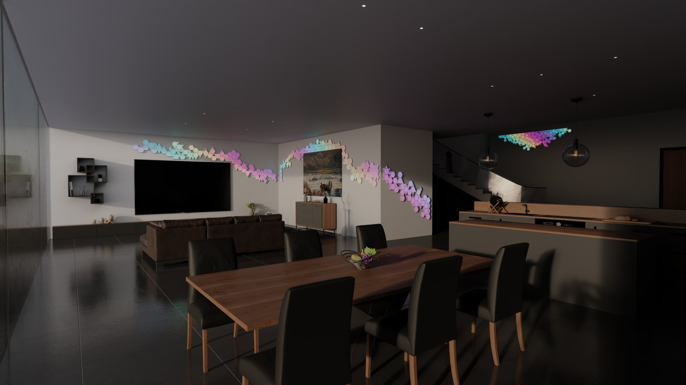
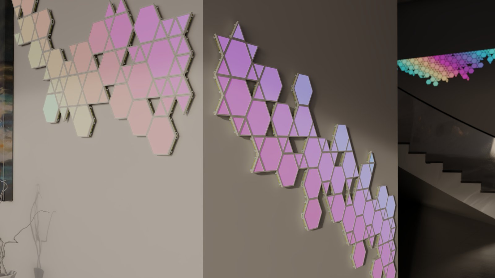
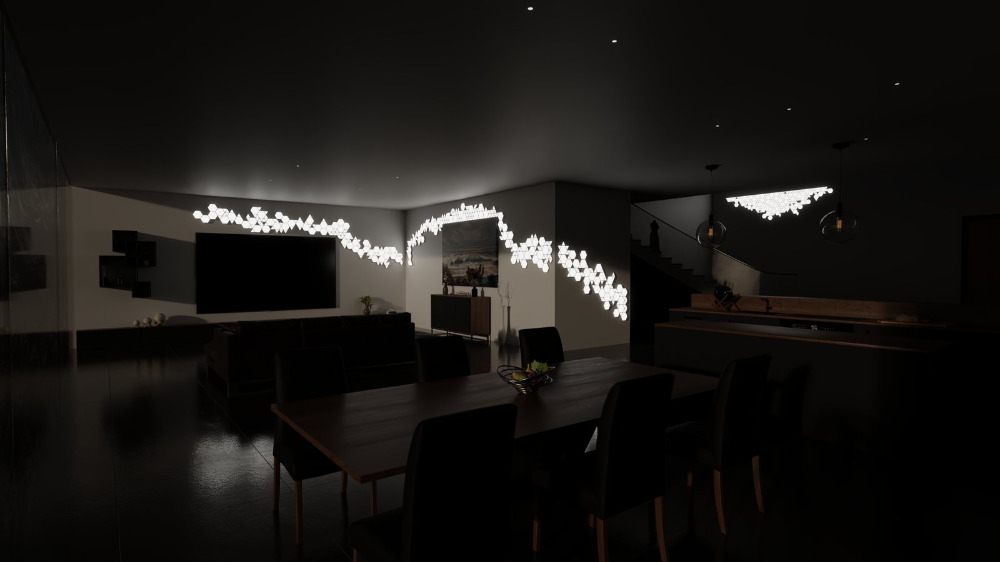
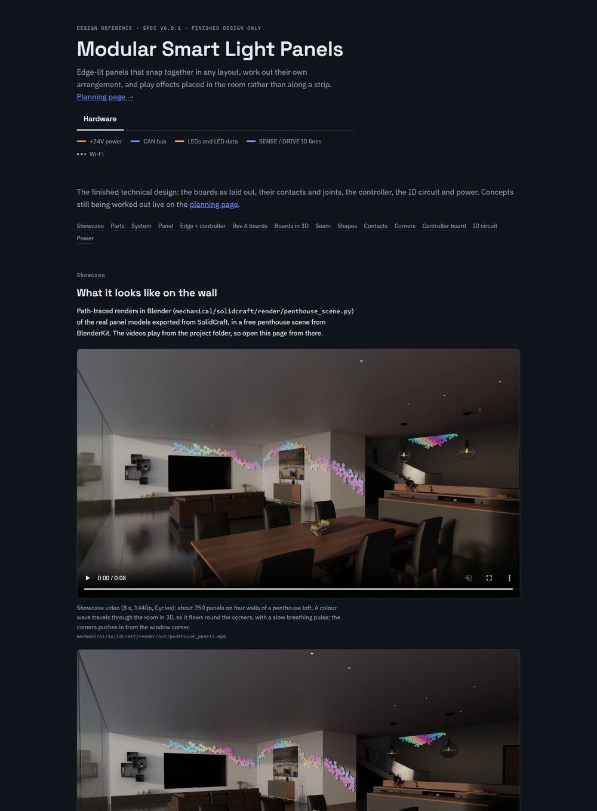
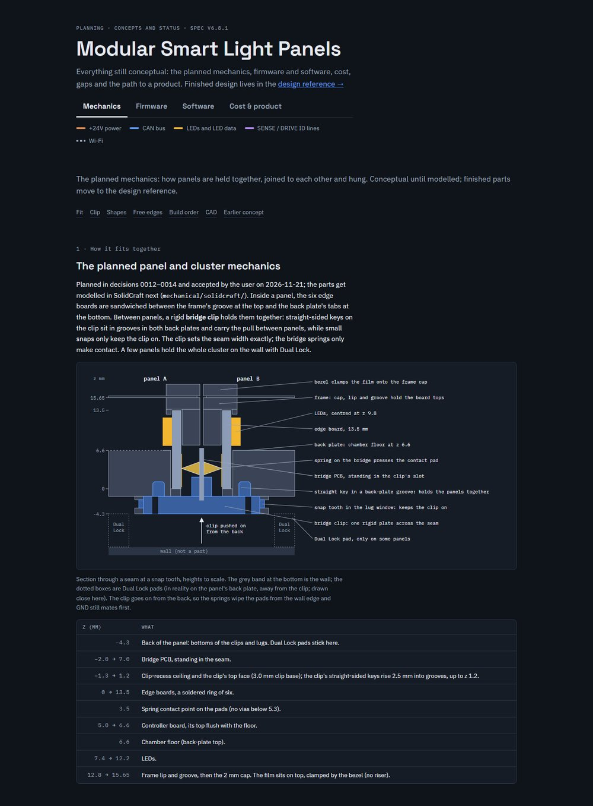
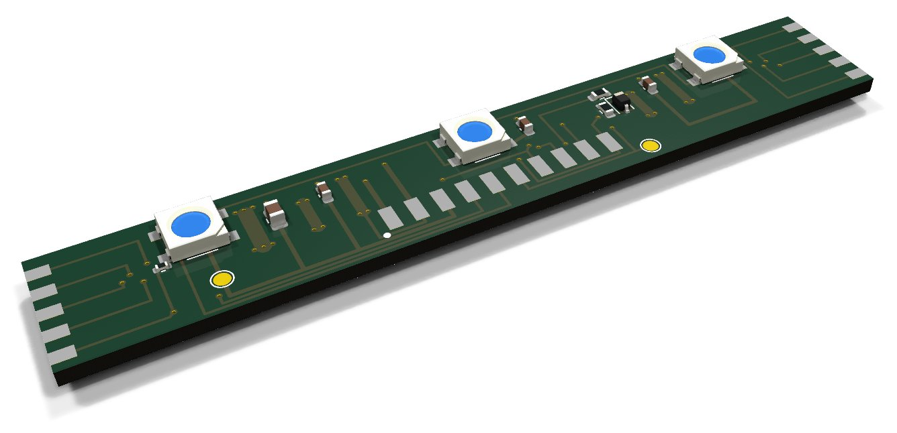
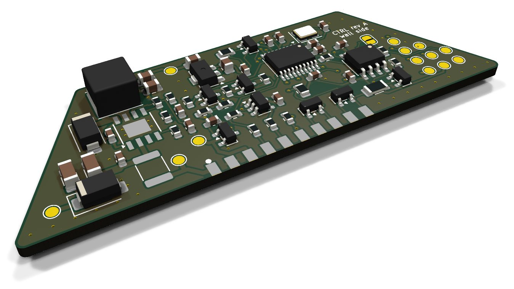
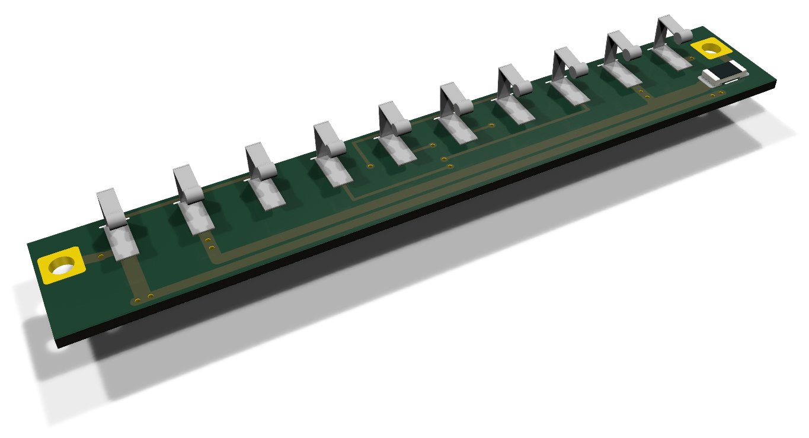
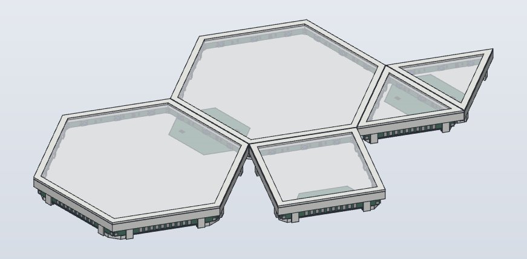
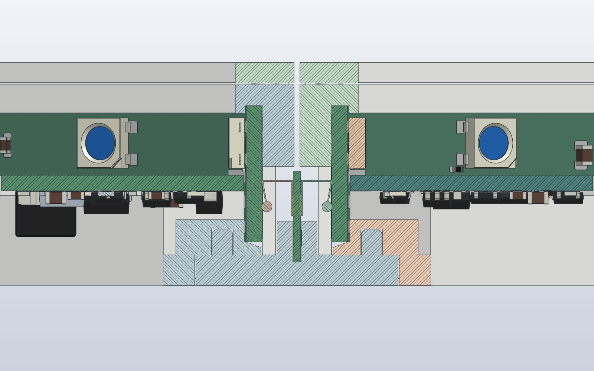

# Modular Smart Light Panels

Edge-lit hexagon, square and triangle light panels that snap together in any layout, work out their own arrangement, and play effects placed in the room rather than along a strip. The master design document is [SPEC.md](SPEC.md); every design decision and its reasons are in [docs/decisions/](docs/decisions/).

**Status:** rev A design done (boards laid out and DRC-clean, mechanics first pass in CAD). The rev A test prototype is three triangle panels ([decision 0016](docs/decisions/0016-triangle-test-model.md)); the path to it is [docs/roadmap-to-prototype.md](docs/roadmap-to-prototype.md).



| Close-up at an outside corner | Maximum brightness, night (panels light the room) |
|---|---|
|  |  |

**Videos (1440p):** [wide shot](mechanical/solidcraft/render/out/penthouse_panels.mp4) · [close-up](mechanical/solidcraft/render/out/penthouse_closeup.mp4). Rendered in Blender (Cycles) from the real panel CAD and board models; how they're made is in [mechanical/solidcraft/render/CREDITS.md](mechanical/solidcraft/render/CREDITS.md).

## The explainer

Two illustrated pages walk through the whole design, with diagrams, renders, the boards in 3D, the CAD and cross-sections:

| [Design reference](docs/diagrams/design-reference.html) (finished design) | [Planning](docs/diagrams/planning.html) (mechanics, firmware, software, cost) |
|---|---|
| [](docs/diagrams/design-reference.html) | [](docs/diagrams/planning.html) |

GitHub shows HTML files as source, so open them from a clone or download (`docs/diagrams/*.html`; the videos play when the page is opened inside the project folder). They are rebuilt by `python docs/diagrams/build_explainer.py`.

## Hardware (KiCad 9)

| Edge board (triangle, inward face) | Controller board | Seam bridge |
|---|---|---|
|  |  |  |

- **Edge boards** ([hardware/edge-board/](hardware/edge-board/)): passive 2-layer boards, one layout for all three shapes (hexagon 94.1 mm, square 89.8 mm, triangle 82.33 mm): three SK6812 RGBW LEDs, the ID circuit, spring contact pads on the exterior face, corner joints, and the controller joint. Built by script from the generated schematic; notes in [LAYOUT-NOTES.md](hardware/edge-board/LAYOUT-NOTES.md).
- **Controller board** ([hardware/controller-board/](hardware/controller-board/)): 4-layer, CH32V203 + CAN + 24 V buck, soldered at 90° to one edge board per panel.
- **Seam bridge** ([hardware/bridge/](hardware/bridge/)): 0.8 mm board with 20 spring contacts that joins two panels' buses and power; plus a spring test coupon.
- Fab outputs (Gerbers, BOMs, JLC CPLs) are in each board's `output/`.

## Mechanics (SolidCraft)

| Mixed cluster | Section across a seam |
|---|---|
|  |  |

Parametric printed parts with Hexagon / Square / Triangle configurations in [mechanical/solidcraft/](mechanical/solidcraft/) (back plate, frame, bezel with diffuser film, bridge clip, edge cover, printable stand-ins). STLs in `stl/`, STEPs in `step/`; details in [mechanical/solidcraft/README.md](mechanical/solidcraft/README.md).

## Folder layout

```
SPEC.md                    Master design specification (version and changelog at the top)
docs/
  decisions/               Decision records (context, options, choice, consequences)
  roadmap-to-prototype.md  Work packages and status up to the rev A prototype
  gap-analysis.md          Open questions and how they were closed
  diagrams/                Explainer pages and their generator, 3D/CAD snapshot scripts
  datasheets/              Component datasheets
  mechanical/, reviews/, handoff/, bringup/
hardware/
  edge-board/              Edge boards (hex / square / triangle projects), scripts, fab output
  controller-board/        Controller board, schematic generator for all boards
  bridge/                  Seam bridge and spring test coupon
  lib/                     Project footprints, symbols and 3D models ("ModularLight")
  cluster-controller/      ESP32 cluster controller (planned)
  archive/                 Superseded designs
mechanical/
  solidcraft/              Panel CAD, STL/STEP exports, assembly, renders (render/)
  archive/                 Superseded OpenSCAD concept
firmware/                  CH32V203 node, bootloader, ESP32 controller, shared CAN protocol (to be written)
software/                  Coordinator, AR app, simulator, tools (planned)
production/                Released fab packages, once ordered
```

## Not in the repository

- The penthouse render scene (334 MB, over GitHub's file limit): re-download "Modern Loft Apartment" by Matteo Pascale from BlenderKit (free) into `mechanical/solidcraft/render/assets/penthouse/`; see the render credits.
- Backups (`*.bak`), KiCad caches and render scratch files.
