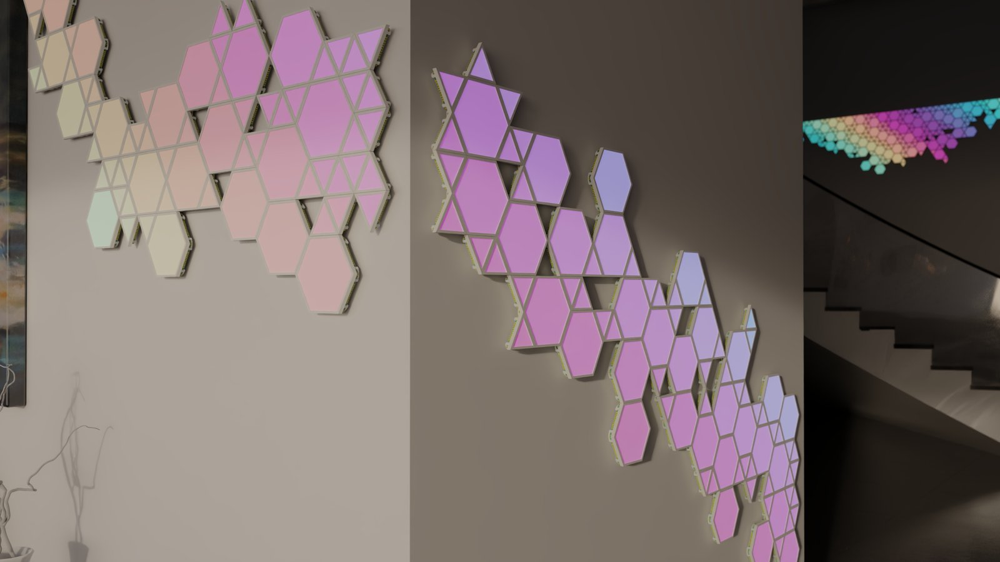
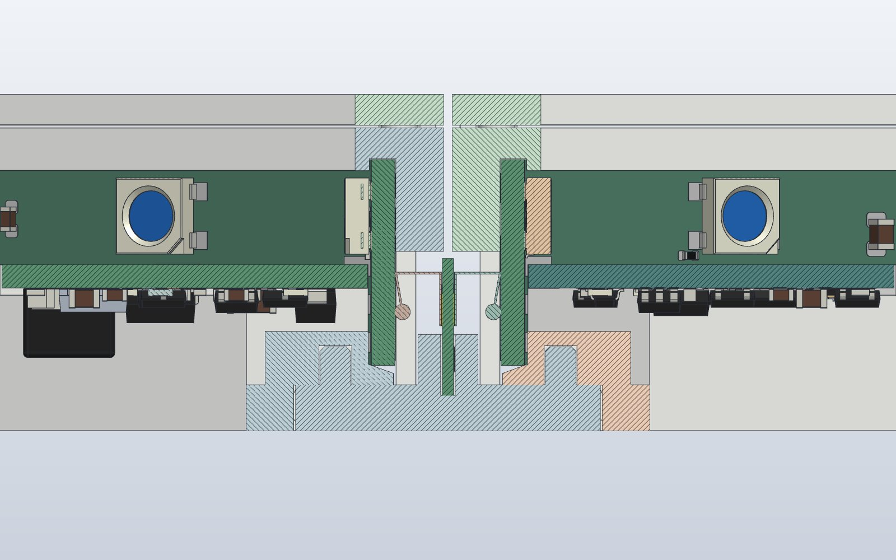
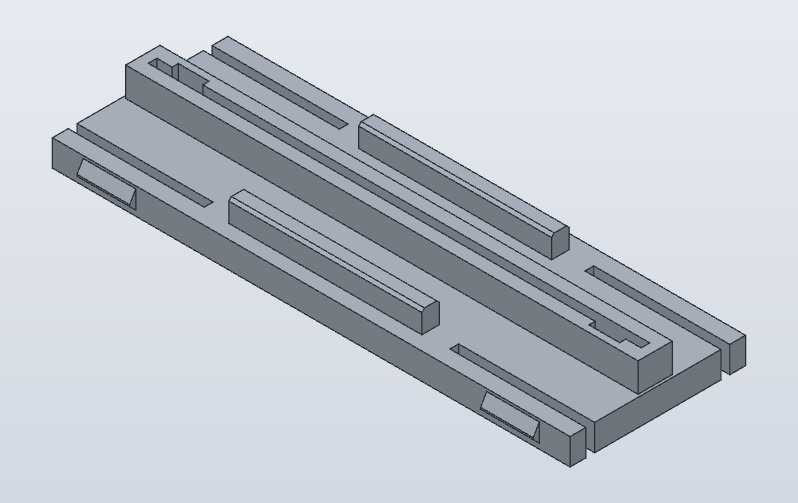

# Modular Smart Light Panels

Edge-lit hexagon, square and triangle light panels that snap together in any layout, work out their own arrangement, and play effects placed in the room rather than along a strip.

**Read the design in [SPEC.md](SPEC.md)**, with the reasons for each decision in [docs/decisions/](docs/decisions/). They are the only written description of the design; this page and the pictures only point into them. Progress toward the first prototype is tracked in [docs/roadmap-to-prototype.md](docs/roadmap-to-prototype.md).


| Close-up at an outside corner | Maximum brightness at night |
|---|---|
|  |  |

Videos: [wide shot](mechanical/solidcraft/render/out/penthouse_panels.mp4) · [close-up](mechanical/solidcraft/render/out/penthouse_closeup.mp4).

## Where things are described

| Topic | Spec section | Pictures |
|---|---|---|
| Panels, shapes, optics | [§2](SPEC.md#2-physical-architecture--optical-design) |  |
| Seam contacts and bridge | [§3.3](SPEC.md#33-edge-contacts-and-bridge) |  |
| Edge and controller boards | [§3.5](SPEC.md#35-board-types-v60-decision-0009) |  |
| Topology discovery | [§4](SPEC.md#4-topology--orientation-discovery) | |
| Network, rendering, software | [§5–7](SPEC.md#5-network-topology) | |
| Power, brightness | [§8](SPEC.md#8-power-distribution--protection) |  |
| Mechanics (printed parts) | [§9](SPEC.md#9-mechanical) |  |

## Repository layout

```
SPEC.md                    The specification (version and changelog inside)
docs/
  decisions/               Decision records: context, options, choice, consequences
  figures/                 Generated pictures (make_figures.py); never edited by hand
  roadmap-to-prototype.md  Work packages and status
  gap-analysis.md, reviews/, mechanical/, datasheets/, bringup/, handoff/
  archive/explainer/       Retired HTML explainer (superseded by SPEC.md + figures)
hardware/                  KiCad 9: edge-board/, controller-board/, bridge/ (+ coupon/), lib/, archive/
mechanical/solidcraft/     Printed parts, assembly, STL/STEP exports, render/ (Blender scene scripts)
firmware/, software/       To be written
production/                Released fab packages, once ordered
```

Each design folder has its own notes (for example `hardware/edge-board/LAYOUT-NOTES.md`, `mechanical/solidcraft/README.md`) for how its files are built.

## Regenerating

- Figures: `python docs/figures/make_figures.py --all` (KiCad 3D views and SolidCraft snapshots, then the web copies).
- Renders: `python mechanical/solidcraft/render/render_batch.py` (Blender, GPU; slow). The penthouse scene file is not in git (over GitHub's file-size limit): get "Modern Loft Apartment" by Matteo Pascale from BlenderKit (free) into `mechanical/solidcraft/render/assets/penthouse/`, as described in `render/CREDITS.md`.
