# Modular Smart Lighting System — Architectural & Design Specifications

**Version:** V6.9.5 (2026-11-22) — supersedes V4. See [Changelog](#11-changelog).

This file is the source of truth. Design decisions are recorded in [docs/decisions/](docs/decisions/). When a decision changes anything here, this file is updated in the same change.

---

## 0. Goal & Scope

A low-cost, edge-lit, snap-together light panel system that scales from a single wall to **multiple rooms (100+ panels)**: walls, ceilings, and multi-level spaces (lofts, split-levels, balconies, dens). The two defining features:

1. **Self-configuring.** Panels snap together in any arrangement. The system discovers the full topology (which panel touches which, through which edge) and each panel's orientation, with no manual layout entry.
2. **Room-scale 3D effects.** Animations live in room coordinates (a sparse 3D voxel space), not in strip order or a 2D grid. Effects flow continuously across walls and ceilings and respect real-world gravity.

**Scope:** personal build for the author's home. Certification (FCC/UL/CE) is not a goal. Safety margins (fusing, current ratings, thermal) still apply because of the power levels involved.

## 1. Terminology

| Term | Meaning |
|---|---|
| **Edge board** | One straight, **passive** PCB forming one side of a polygon panel: LEDs, ID diode and resistor, contacts and lanes. All edge boards of a shape are identical; only the length differs per shape (§2, decision 0004). (V6.0: there is no active edge board any more.) |
| **Controller board** | A small 4-layer board lying flat at the rear of each panel's light chamber, inside the enclosure: MCU, CAN transceiver, 24 → 5 V converter, LED-rail switch, level shifter, 3.3 V regulator, protection. One design for every shape. Drag-soldered at 90° to the code-0 edge board ([decision 0009](docs/decisions/0009-rear-controller-board.md)). |
| **Code-0 edge board** | The edge board the controller board joins. Its ID resistor is code 0 (0 Ω), and the LED chain starts and ends there. |
| **Panel** | A closed polygon (triangle, square, hexagon) of N edge boards plus a diffuser. |
| **Corner connection** | The internal electrical joint between two edge boards at a polygon corner, within one panel. |
| **Edge contacts** | Ten plated pads on the **exterior face** of an edge board, along its wall edge: power and signal nets. They carry no parts. |
| **Bridge** | A thin double-sided **bridge PCB** standing upright in the seam between two adjacent panels. Low-cost **top-contact SMT springs** on each face press on the facing panel's edge contacts. A rigid printed **bridge clip** across the back of the seam holds it upright in a slot and **snaps onto both panels' back plates with zero play**: **straight-sided keys** (chamfered at the top) on the clip sit in grooves in both back plates and carry the pull between panels, and four in-plane snap arms put teeth (latch faces sloped ≈25°) into lug windows only to keep the clip on; no screws. The clip sets the seam width and carries every load between panels, so a cluster is one rigid assembly ([decision 0014](docs/decisions/0014-rigid-snap-bridge-clip.md)). All springs are machine-placed from tape and reel. |
| **Cluster** | A set of panels joined by bridges on one flat surface. |
| **Cluster controller** | A snap-on ESP32 module, one per cluster. It owns that cluster's CAN bus and bridges it to Wi-Fi. |
| **CAN segment** | One physical CAN bus. Normally one cluster per segment, owned by its cluster controller. |
| **Coordinator** | The single system brain (Raspberry Pi or a designated cluster controller). It holds the Room Layout and runs the voxel engine across all cluster controllers. |

## 2. Physical Architecture & Optical Design

*Figures are generated from the design files by `docs/figures/make_figures.py`; the text below is the specification.*

| Mixed cluster (SolidCraft) | Back of the cluster |
|---|---|
| 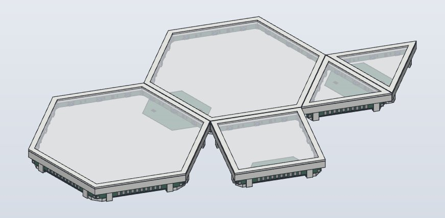 | 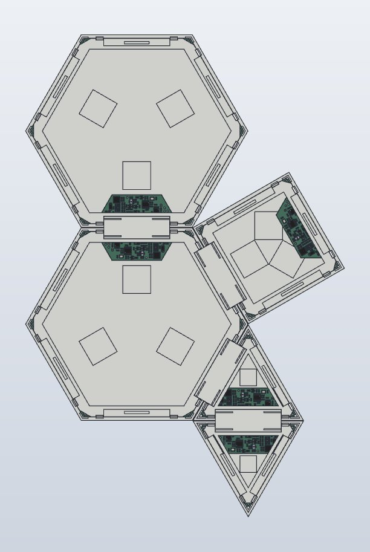 |

- **Edge-lit optics:** Perimeter-mounted, inward-facing addressable **RGBW** LEDs (SKC6812RGBW, neutral white, on a per-panel 5 V rail; see [decision 0003](docs/decisions/0003-rgbw-leds-5v-rail.md)) with a shallow internal air gap, a white matte back reflector, and a thin **LCD-style diffuser film** (PET/PC, ≈0.1–0.3 mm, one or two layers) **clamped flat between the frame cap (or a riser ring) and a bezel ring** registered on corner pins ([decision 0012](docs/decisions/0012-panel-mechanics-rev-a.md)). Thick acrylic is not required. The goal is smooth, hot-spot-free color blending in a slim profile; the optics test must confirm the film hides individual LEDs (see the gap analysis).
- **Common edge length:** All shapes share one nominal edge length of **≈100 mm**, measured on the **seam centrelines** (the lines along which panels tile), so triangles, squares, and hexagons can mate with each other. A hexagon is ≈200 mm across its corners and ≈173 mm across its flats (0.026 m²), which fits common 220–256 mm print beds in one piece.
- **LED density:** **2–3 LEDs per edge** (33–50 mm pitch): 12–18 per hexagon, 8–12 per square, 6–9 per triangle. Budget figures below assume 3. **LEDs are centred along the edge board and evenly spaced** (with 3, the middle LED sits at the board centre, x = 0, and the outer two at about L_board/3: ±31.2 hexagon, ±29.9 square, ±27.4 triangle; [decision 0015](docs/decisions/0015-square-triangle-edge-boards.md)).
- **Polygon framing:** Edge boards stand upright in a closed-loop polygon. The outer perimeter is larger than the inner one, which creates small V-gaps at the external corners that the corner joints span.
- **Fixed seam inset, board length per shape** ([decision 0004](docs/decisions/0004-per-shape-board-lengths.md)):
  - **Inset:** the seam bridge needs a fixed gap, so every board's exterior face sits **d = seam/2** from the seam centreline, the same for every shape. d is set by the measured spring stack; ≈3.5 mm is assumed for now.
  - **Board length:** board length therefore depends on the corner angle α. Measured along the inward face, with square-cut ends meeting at each inner corner: **L_board = L − 2·(d + t) / tan(α/2)**, with t = 1.6 mm board thickness.

  | Shape | α | L_board (L = 100, d = 3.5) |
  |---|---|---|
  | Hexagon | 120° | ≈ 94.1 mm |
  | Square | 90° | ≈ 89.8 mm |
  | Triangle | 60° | ≈ 82.3 mm |

  - **Layout:** one schematic and one layout core (contacts, LEDs, ID circuit, controller-joint pads), placed relative to the board centre and fitting the triangle length. Each shape gets its own board outline; longer variants only extend the ends to their corner joints.
  - **Bridges:** a centred contact strip lines up between any two shapes, so bridges stay universal.
  - **Build order (V6.9, [decision 0016](docs/decisions/0016-triangle-test-model.md)):** **the rev A test prototype is built from triangle panels** (3 edge boards + 1 controller each: the fewest parts and the least printing). Hexagon and square follow from the same board generator and the same parametric printed parts once the triangle passes; the hexagon gets one optics check first (widest LED pitch, 31.2 mm).
- **Edge board layout (V6.0, [decision 0009](docs/decisions/0009-rear-controller-board.md)):** every edge board is the same passive 2-layer board. **Rev A height H = 13.5 mm** (target was 10–15 mm; 13 mm left the bus unroutable past J4), down from 22 mm. Outlines 94.1 / 89.8 / 82.33 × 13.5 × 1.6 mm (hexagon / square / triangle), square-cut ends; one KiCad project per outline (`edge-board-hex`, `-square`, `-triangle`), one circuit and **one layout for all three** (only the outer LEDs and the end zone move with the shape; user: keep the boards as alike as possible), built by one script ([decision 0015](docs/decisions/0015-square-triangle-edge-boards.md)). Layout: `hardware/edge-board/LAYOUT-NOTES.md`.
  - **No zoning rule:** lanes and the bus may run on either face at any height. Only these constraints apply, each for a stated reason:
    - **Edge contact pads on the exterior face, within the springs' contact zone (§3.3):** the seam bridge presses there.
    - **Mating order:** GND pads reach closest to the wall edge, so GND connects first when a panel slides in.
    - **Preference:** keep DRIVE away from +24V. Since decision 0011 a DRIVE-to-24 V short is survivable (open-drain driver, 470 Ω), so this is no longer a damage rule.
    - **+24V copper may only sit next to GND or 24 V-tolerant nets (CAN, SPARE, SENSE, DRIVE, and the buck's own SW/BOOT/EN nodes),** never next to +5V_LED, LED data or LED return: those nets reach LED or logic inputs that 24 V destroys (decision 0011). Implemented on the controller as ≥1.0 mm from +24V to any other net, with GND poured between.
    - **LED positions:** x = 0 and ±31.2 (hexagon), ±29.9 (square), ±27.4 (triangle) from the board centre; z 9.8 on all shapes. Evenly spaced across corners (decision 0015).
    - **Board thickness 1.6 mm:** sets the seam inset and the corner geometry (decision 0004).
  - **Current is low:** at 24 V a hexagon draws ≈0.18 A and a feed path a few amps, so plain 1 oz copper lanes are enough. No solder-bead reinforcement and no crossover jumpers.
  - **Superseded:** decision 0005's exterior lane stack and H = 22 mm, decision 0006's active/passive split, and decision 0007's active-board-only via rule (in-pad vias are now simply allowed where useful).

## 3. Electrical Design

### 3.1 Voltage architecture
- **24 V DC distribution** (V6.0, [decision 0010](docs/decisions/0010-24v-bus.md)), up from 12 V.
  - It halves the bus current, which halves the current through the seam-bridge springs (their rating is still unconfirmed) and allows narrower lanes on the short edge boards.
  - Everything connected directly to +24V is rated above the SMAJ28A's ≈45 V clamp, or sits behind a series resistor.
  - The LEDs run from the 5 V rail made on each panel's controller board.

### 3.2 Controller board circuitry
Parts carried over from the V5 active edge board (decisions [0001](docs/decisions/0001-edge-board-parts.md), 0003 and 0008), changed for 24 V by [decision 0010](docs/decisions/0010-24v-bus.md). The controller board is a new 4-layer KiCad project, still to be created. Its schematic starts from the V5 active board in [hardware/archive/edge-board-v5/](hardware/archive/edge-board-v5/).

| Function | Choice | Notes |
|---|---|---|
| MCU | **CH32V203F6P6** (TSSOP20) | Native CAN on PA11/PA12. In TSSOP20 only the F6 has CAN; **the F8P6 has no CAN**. The datasheet's 32 KB is the zero-wait area only; every V203 has 224 KB flash in total. 10 KB SRAM. |
| Clock | **8 MHz crystal** (3225, 12 pF, ±10 ppm) + 2 × 15 pF | CAN bit timing needs crystal accuracy. Uses PD0/PD1. |
| CAN transceiver | **TCAN1044VDRQ1** (C1852061, SOIC-8) | Bus pins survive **±58 V** faults, so a 24 V short on the contacts doesn't destroy it (the V5 SN65HVD230 only survives −4…16 V). VCC from the always-on +5V, VIO from 3V3. Standby pin on a GPIO; it wakes on bus traffic. |
| Logic regulator | **HT7533-1** (SOT-89), fed from the always-on **+5V** | At 5 V in it dissipates only ≈50 mW, so the V5 68 Ω series resistor is removed. At 24 V its 30 V input limit would be too close. |
| Protection | **SMAJ28A** (C134977) on +24V, behind a **per-panel PTC F1 upstream of it: mSMD050-60V** (TECHFUSE C70113, 1812, 0.50 A hold / 1.0 A trip, 60 V). Joint pad 1 lands on `+24V_IN`; F1 joins it to `+24V`. **CAN TVS NUP3105LT1G** (DOWO C22390031: 36 V standoff, ≤60 V at 6 A, 16 pF), also on SENSE/DRIVE. **SENSE:** R_pu and R10 both 10 kΩ 0805, BAT54S on the ADC side. **DRIVE:** open-drain 2N7002 (gate PA4, 100 k pull-down) + R11 470 Ω 1206; no DRIVE clamp. **3V3 shunt:** TLV431A trips at ≈3.56 V. | [Decision 0011](docs/decisions/0011-24v-fault-protection-controller.md). A sustained 24 V short on SENSE or DRIVE is survivable. The PTC localises a controller fault to its own panel. Every part on +24V is rated above the SMAJ28A's ≈45 V clamp. F1 holds ≥0.30 A up to 70 °C against a 0.27 A worst-case load (bus sagged to 18 V); drop ≤0.27 V (SCHEMATIC-NOTES §2.1). |
| 5 V rail | **TPS54360B** buck (C524806), **always on** (EN open): 600 kHz (RT 162 k), **L 22 µH FNR6045S220MT** (C168080, 4.5 mm tall), C_OUT 2 × 22 µF, FB 53.6 k / 10.2 k (5.00 V), compensation 4.7 k + 22 nF ∥ 100 pF, SS36 catch diode, C_IN 2 × 10 µF 50 V + 100 nF | Load ≈0.73 A for 18 LEDs plus logic; ≈87.5 % efficient at 24 V. The 2.8 mm inductor alternative was rejected because it would saturate on a +5V short (decision 0011). The 4.5 mm height sets the back-plate pocket depth (§3.5). |
| LED rail switch | **AO3401A** (C15127) P-MOSFET on +5V → **+5V_LED**, driven by a 2N7002 from **PA0 (LED_EN)**. Gate network 100 k pull-up, 22 k, 22 nF gate-drain for a ≈0.9 ms soft start; default off (100 k pull-down on PA0). | Replaces the V5.3 buck-enable switching: the buck stays on for the MCU and CAN in standby. Firmware sends all-zero LED data before switching the rail off. |
| LED level shifter | **SN74AHCT1G125** (UMW, C20617903), powered from **+5V_LED**, OE̅ to GND | SK6812 VIH ≈ 3.5 V at 5 V. Powered from the switched rail, so it can't back-power unlit LEDs; holding PA7 low while the rail is off is only recommended. |
| CAN termination | 120 Ω + solder jumper (open) | Closed only on the controller board chosen as a segment's far end. |
| LED data out | PA7 (SPI1_MOSI + DMA) → level shifter → 33 Ω → LED1 DIN | LED: **SKC6812RGBW-NW** (C5348912), 5 V, 32-bit GRBW, no backup data line. Warm white (-WS, C5378724) is a drop-in alternative. |
| LED loopback in | Last LED DO (5 V logic) → **2.2 kΩ / 3.3 kΩ divider** (3.0 V) → **PA6** (TIM3_CH1 as external clock counts the returned bits, 32 per LED; V5.7 pin swap, decision 0008). | Lets firmware count the LEDs (§7.3). **PA6 is not 5 V tolerant**, so the divider is required. On the CH32V203 only FT pins take 5.5 V. The datasheet pin table (V2.8) gives PA6 (TSSOP20 pin 12) no FT mark, the same as PA0, the old loop-back pin, so it is limited to VDD + 0.3 V. PA0 now drives the LED-rail switch. |
| Debug / programming | Pads for SWDIO, SWCLK, NRST, 3V3, GND, UART TX/RX (PA2/PA3), PB1 spare, +24V_IN (TP10, before F1), +24V (TP13, after F1), +5V, +5V_LED | For a pogo-pin jig (WCH-LinkE). Edge boards carry +24V/+5V_LED/GND test pads, so the jig can test their LEDs too. **Rev A:** TP1–TP9 in the right-hand corner area with the WCH-LinkE set in TP2–TP6; the jig needs relief for L1. Coordinates: LAYOUT-NOTES.md. |
| Joint to the code-0 edge board | **10 pads at 2.54 mm**, in the order **+24V, GND, +5V_LED, LED_RETURN, LED_DATA_OUT, SPARE, CANH, CANL, SENSE, DRIVE**. Footprints ControllerJoint_ControllerEdge / ControllerJoint_EdgeBoard; pad n meets pad n. On the controller the pads are on its **parts side** (the wall side). Drag-soldered at 90° to the code-0 edge board's inward face. | +24V sits at the end with only GND beside it; DRIVE is at the far end; LED data is kept off +5V_LED. Order and reasons: SCHEMATIC-NOTES §6. The joint pads exist on every edge board; only the code-0 board's are used. |

### 3.3 Edge contacts and bridge

| Section across a seam, through a spring | Seam bridge | Edge board, exterior face (contacts) |
|---|---|---|
| 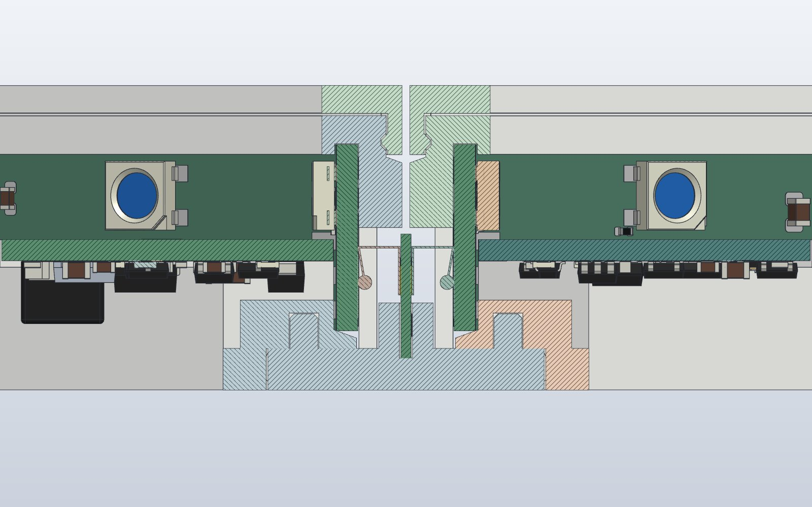 | 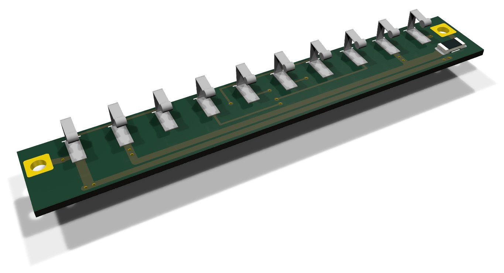 | 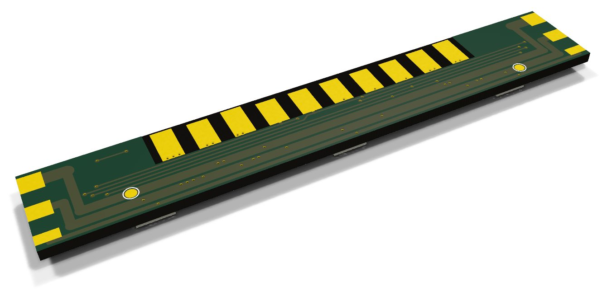 |

Rationale: [docs/decisions/0002-seam-bridge-cheap-springs.md](docs/decisions/0002-seam-bridge-cheap-springs.md). This replaces V5.1's flat bridge with Harwin side springs.

- **Concept (seam bridge):** the bridge is a thin (≈0.8 mm) double-sided PCB that stands **upright in the seam** between two adjacent panels, parallel to their edge boards, at the wall edge.
  - Low-cost **top-contact SMT springs** on each face of the bridge press straight onto contact pads on the facing panel's **exterior face**.
  - **Bridge clip** ([decision 0014](docs/decisions/0014-rigid-snap-bridge-clip.md)): a rigid printed **bridge clip** across the back of the seam holds it upright in a slot and **snaps onto both panels' back plates with zero play**: **straight-sided keys** (chamfered at the top) on the clip sit in grooves in both back plates and carry the pull between panels, and four in-plane snap arms put teeth (latch faces sloped ≈25°) into lug windows only to keep the clip on; no screws. The clip sets the seam width and carries every load between panels, so a cluster is one rigid assembly ([decision 0014](docs/decisions/0014-rigid-snap-bridge-clip.md)). About 59 × 20 mm with a 3.0 mm base (z −4.3 to −1.3), so one clip fits every pair of shapes: tooth notches at |x| 20–26, 10–11 mm from the seam; the keys rise to z 1.2 and engage the grooves 2.5 mm (2.2 mm of straight wall under a 0.3 mm key chamfer; the groove mouths are square). On the controller side a cross-bar across the open pocket (z −1.3 to 2.2) carries the key groove and the notches. Clusters are assembled face down and the clip goes on from the back, so the springs still wipe the pads from the wall edge (GND first). Free edges get an **edge cover** on the same lugs, covering the exposed pads. Plan: `docs/mechanical/assembly-plan.md`.
  - **Bridge envelope (rev A mechanics):** top ≤ z 7.0, |x| ≤ 28, nothing on its faces below z 2.2 (carrier slot), spring contact ≤ z 5.0.
  - **Rev A bridge PCB:** 56 × 9.0 × 0.8 mm ENIG, bottom edge at panel z −2.0, top at 7.0; 10 springs per face at x −22.5…+22.5 (5 mm pitch), contact ends toward the wall, contact points at z 3.5. Face B is the 180° image of face A with the SENSE/DRIVE cross. Needs JLC double-sided assembly. The bridge CAN TVS was left out for lack of room. Layout: `hardware/bridge/BRIDGE-NOTES.md`; spring test coupon in `hardware/bridge/coupon/`.
  - Every spring is machine-placed from tape and reel; nothing is hand-placed.
- **Edge contacts (on the edge board):** plated (ENIG) pads on the **exterior face (B.Cu) only**, along the wall edge. Footprint `ModularLight:EdgeContacts_SpringPads`, revised for one face. There are no contact pads on the inward face. Bevel the wall edge for lead-in.

| Pad | X1 | X2 | X3 | X4 | X5 | X6 | X7 | X8 | X9 | X10 |
|---|---|---|---|---|---|---|---|---|---|---|
| Net | GND | +24V | GND | CANH | CANL | DRIVE | SENSE_EDGE | SPARE | +24V | GND |

  - **Size:** ≈3.0 mm wide at ≈5.0 mm pitch, centred on the board (≈48 mm span), giving a 1.5 mm-wide spring about ±0.7 mm lateral tolerance.
  - **Positions:** symmetric about the board centre, so spring forces balance across the bridge. The order is flexible because the bridge routes nets itself, with three rules:
    - Keep GND outermost and +24V next in.
    - **DRIVE (X6) must not sit next to a pad that can carry 24 V.** A DRIVE↔24 V short burns R11 and back-feeds the 3V3 rail. DRIVE therefore sits between CANL and SENSE_EDGE, away from SPARE. SENSE_EDGE next to SPARE is safe because D1 blocks it.
  - **Signal routing:** signal nets reach their exterior pads through vias above the strip, or in the top end of each pad ([decision 0007](docs/decisions/0007-vias-in-pads-active-board.md)'s method, now allowed on every edge board). The layout picks whichever keeps the board shortest.
  - **Contact strip (built into the footprint):** a B.Cu rule area over the strip allows no copper pour and no vias, so the springs only ever touch pads or bare board. Tracks are allowed, so the +24V/GND pads neck out from their top ends into their lanes. The solder mask is opened over the whole strip (gold-finger style), so springs never wipe across a mask edge.
    - **Bridge constraint:** the spring's final contact point, including tolerances, must stay below the in-pad vias. **Rev A: no-via area to z 5.3, in-pad vias at z 5.4–6.0, so the contact point must stay ≤ z 5.0** (nominal 3.5, estimated ±1.0 mm). Replaces V5.7's 6.8 mm.
  - **Mating order:** GND pads reach to 0.3 mm from the edge, +24V to 0.6 mm, signals to 0.9 mm. The panel slides toward the wall, so GND touches its springs first and signals last. GND is outermost and +24V next, so under any tilt an outer GND pad still makes first, then +24V, then signals.
  - **Contact zone:** **rev A pads X1–X10 at x = −22.5 + 5·(n−1), 3.0 mm wide, end at z 6.0** (they start at 0.3/0.6/0.9 per the mating order); solder mask open to z 6.1.
- **Bridge springs:**
  - **Primary:** **BW0019CG-L3.5W1.5H4.3** (LCSC C2826517, gold-plated SUS301, 3.5 × 1.5 × 4.3 mm, ≈$0.024).
  - **Alternate:** BW0019BG-L3.5W1.5H3.8 (C2826516).
  - **Count:** 10 per board face, 20 per bridge.
  - **Orientation:** mount each spring with its cantilever's free end pointing toward the wall, so the bevelled board edge rides up the spring instead of snagging it.
  - **Ratings** (BW0019CG datasheet, docs/datasheets/springs/BW0019CG.pdf):
    - contact resistance 30 mΩ
    - force 60–80 gf (≈0.7 N)
    - 20,000 cycles
    - free height 4.3 mm, normal working height 3.5 mm, minimum 3.0 mm
    - SUS301 with gold over nickel at the contact
    - **No current rating is given** (it is an RF antenna spring), so assume ≈1 A per spring until measured on the prototype. If more current is needed, add power pads and springs, which are cheap.
- **Seam width:** bridge PCB (≈0.8 mm) plus two springs at 3.0–3.5 mm working height: **≈6.8–7.8 mm**, so d = seam/2 ≈ 3.4–3.9 mm (§2 assumes 3.5 mm).
- **Net mapping:** the bridge PCB routes each net with its own traces, including the **SENSE↔DRIVE cross-connect** (one panel's SENSE_EDGE meets the other's DRIVE). The edge pinout does not have to be a palindrome. The bridge layout is 180° symmetric, so it works in either orientation.
- **Forces:** the springs push the two panels apart. Each board sees ≈10 × 0.6–0.8 N ≈ 7 N toward its panel's interior, so the panel frame and snap fit must take it. Inside a tiled cluster the forces mostly cancel; at cluster edges they don't.
- **Spare contact (X8):** reserved for a switched LED rail (see the standby-power gap) or a later feature.
- **Bridge PCB variants:**
  - **Standard:** all nets connected.
  - **Injection:** adds a supply input and a fuse.
  - **Isolating:** +24V left unconnected, with GND, CAN, and SENSE/DRIVE passed through.
  - A footprint for a CAN TVS on every bridge is recommended.

### 3.4 Corner connections (internal)
Solder bridges or wire staples carry these nets around the polygon perimeter at each internal corner:
**+24V, +5V_LED (switched LED rail), GND, LED DIN, CANH, CANL, SENSE bus, DRIVE bus.** (V5.3: LED BIN was dropped because the RGBW LEDs have no backup data line; the +5V LED rail was added, see [decision 0003](docs/decisions/0003-rgbw-leds-5v-rail.md).)
The LED chain starts at the code-0 board (fed by the controller board) and runs once around the polygon. The **last corner (back into the code-0 board) also carries LED RETURN**: the last LED's data output, looped back to the MCU.
- Each board has a corner-IN joint at its left end (footprint `ModularLight:CornerJoint_L`) and a corner-OUT joint at its right end (`ModularLight:CornerJoint_R`, the mirror image). Both are placeholders until the corner hardware is designed. All pads are SMD and touch the board end.
  - **Inward face:** the five signal pads, **2.0 × 1.3 mm at 2.5 mm pitch at the board ends (x = ±47.05): D z 1.5, CANH 4.0, CANL 6.5, DRIVE 9.0, SENSE 11.5** (rev A), so one solder bead bridges each pair across the corner.
  - **Exterior face (the outside of the polygon):** the +5V_LED, GND and +24V pads, joined across the outside corner by a bent strap or solder bridge. **Rev A: +24V z 0.5–3.5, GND 6.0–8.5, +5V_LED 11.0–12.6.** GND sits between +5V_LED and +24V with ≥2.5 mm gaps: a stray bead joining +24V to +5V_LED would put 24 V on every LED and the level shifter.
  - Corner joints are soldered with the boards held in the frame (§9); the back plate has small reliefs for the inward corner beads.
- Because every edge board is identical, LED RETURN is simply the last board's D_OUT landing on the code-0 board's corner-IN D pad.
  - On the code-0 board, that pad goes to the controller joint (LED return in), and LED1 is fed from the controller's LED data out.
  - On every other board, the corner-IN D pad feeds LED1.
  - **Population option:** R3 (0 Ω) runs from the corner-IN D pad to LED1 DIN, fitted on codes 1–5 and DNP on code 0. The joint's LED_RETURN pad is wired to the corner-IN D pad and its LED_DATA_OUT pad to LED1 DIN.

### 3.5 Board types (V6.0, [decision 0009](docs/decisions/0009-rear-controller-board.md))

| Edge board, inward face | Controller, parts side | Controller, chamber side |
|---|---|---|
| 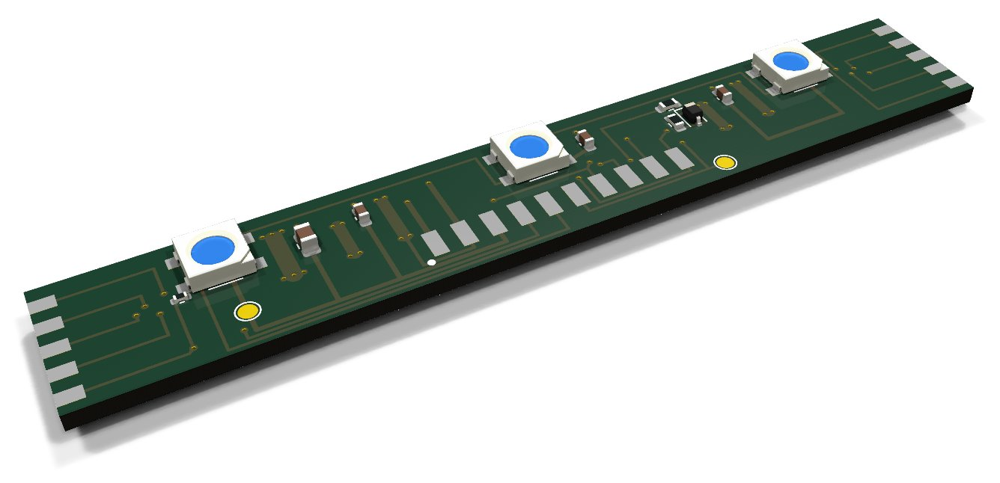 | 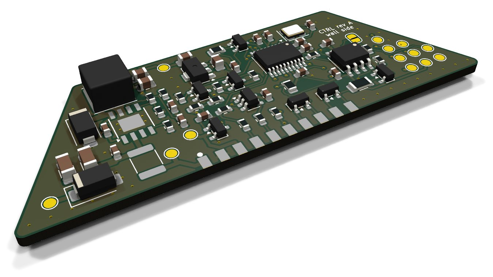 | 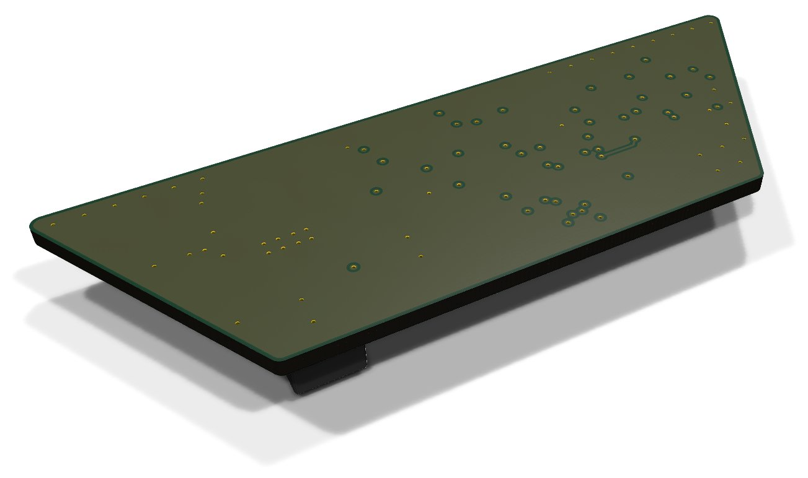 |

- **Edge board (passive, 2-layer):** one design per polygon shape (hexagon first; decision 0004), used for every edge, including the code-0 board.
  - **Parts:** 3 LEDs, decoupling, D1 + R1 (edge ID code: a BOM variant per position, code 0 = 0 Ω), test pads.
  - **Controller-joint pads:** ≈10, used only on the code-0 board.
  - **Population option:** R3 (0 Ω, DNP on code 0) lets the code-0 board's chain start and end at the controller joint. The 10 joint pads (J4, 2.54 mm) sit on every board.
  - This replaces the V5.6 active/passive split (decision 0006).
- **Controller board (4-layer):** one design for every shape.
  - **Placement:** lies flat on the printed back plate at the rear of the light chamber, inside the enclosure.
  - **Orientation:** **parts face the wall** (F.Cu = the wall side). Underside at z = 5.0 mm, top at z = 6.6 mm (the chamber floor). **Stepped pocket** in the back plate: ≥2.8 mm deep under the whole board (pocket floor z ≤ 2.2), plus an **open window through to the wall under L1** (≥7.5 × 7.5 mm; L1 is 4.5 mm tall, the next tallest parts 2.5 mm). The chamber-facing side is plain **white solder mask** over a solid GND layer: no parts, silkscreen or mask openings; vias tented (≈85 dimples) and one 4.3 mm CAN_RX track. It acts as part of the back reflector, so nothing casts shadows into the chamber.
  - **Contents:** everything in §3.2.
  - **Shape:** one design serves every shape, so it is **sized for the smallest panel, the triangle**. **Rev A outline: trapezoid with 60° sides, base 72.0 mm along the code-0 board, depth 24.0 mm, top 44.3 mm, 1 mm corner radii (≈1,394 mm²).** In a triangle (82.3 mm inner side) each slanted side clears the neighbouring edge board by 4.46 mm. A rectangle the length of the edge board would not fit inside the triangle; squares and hexagons have wider corners, so the same board fits them with room to spare. **Stack-up:** 4 layers (parts/signal, GND, signal, GND chamber face), JLC04161H-7628, white mask. Layout: `hardware/controller-board/LAYOUT-NOTES.md`.
  - **Joint:** joined at 90° to the code-0 edge board's joint pads, drag-soldered by hand. The back plate's snap fit holds the board; the solder joint carries no mechanical load. J1 pads at x = −11.43…+11.43 mm (2.54 mm pitch), running to the base edge on the parts side; J4 origin z = 5.25 mm. **Keep-outs:** no controller part in the J1 area and nothing taller than 1.1 mm within 3 mm of either end of the pad row (iron access); on the code-0 board's inward face, nothing but J4 and flat copper below z ≈ 6.8 mm over x = ±36 mm.
- **Interface contract:**
  - controller-joint pad positions and nets
  - LED positions
  - corner pad positions
  - outline length per shape
  - board height (once set)
  - 1.6 mm thickness
- **Hex kit:** one panel of six 2-layer edge boards (R1 codes 0–5, as BOM variants) plus one controller board.
- **Assembly:** small parts on both boards are pasted and reflowed; the corner and controller joints are drag-soldered by hand.

## 4. Topology & Orientation Discovery

### 4.1 Circuit
- **SENSE bus:** Runs around the panel. Pulled up to 3.3V through **R_pu = 10 kΩ** on the controller board and read by the MCU's ADC.
- **DRIVE bus:** Runs around the panel. Connects directly to each edge's DRIVE contact. It is driven by an **open-drain N-MOSFET (2N7002, gate PA4) through 470 Ω** (decision 0011): **off (Hi-Z) when idle**, pulled **LOW** to signal, for ≤5 ms per discovery slot.
- **Per edge:** A **diode (1N4148WS, anode on the SENSE bus) in series with an ID resistor R_k** sits between the SENSE bus and that edge's SENSE contact. It connects only to that edge board's own contact.
- **Why the diode:** without it, a reading panel's SENSE bus reaches an *idle* neighbour's floating DRIVE bus through R_j. From there it can reach a third panel's SENSE bus and, through that panel's R, the panel that is driving. Any 4-hex rhombus contains this path, and it shifts readings across code thresholds. With the diode, every SENSE→DRIVE path conducts one way only: an idle DRIVE bus can charge up but can't sink current. A DNP 0 Ω bypass footprint (R2) allows reverting.
- **ADC input:** 10 kΩ series + 10 nF to GND, BAT54S on the ADC side, plus a TLV431 3V3 shunt (decision 0011). Firmware samples SENSE ≥1 ms after DRIVE goes low.

### 4.2 Edge ID codes (R_pu = 10 kΩ, 1% parts, with series diode)

V_ADC ≈ Vf + (3.3 V − Vf) × R_k / (10 kΩ + R_k), where Vf ≈ 0.45–0.6 V and falls slightly at the lower currents of the higher codes. **Calibrate the thresholds on hardware.**

| Code | R_k | V_ADC (driven, ≈) |
|---|---|---|
| 0 (code-0 board) | 0 Ω | 0.68 V |
| 1 | 1.0 kΩ | 0.91 V |
| 2 | 2.7 kΩ | 1.22 V |
| 3 | 5.6 kΩ | 1.59 V |
| 4 | 12 kΩ | 2.08 V |
| 5 | 27 kΩ | 2.57 V |
| idle / no neighbor driving | — | 3.30 V |

Codes are numbered in order around the polygon, so the code also gives the edge's geometric position relative to the code-0 board.

### 4.3 Discovery protocol (scheduled by the cluster controller over CAN)
1. All nodes enumerate on CAN using their unique 96-bit chip IDs, and the cluster controller assigns short node addresses.
2. For each node B in turn: the cluster controller commands B to pull DRIVE low. Every other node samples SENSE. Any node A that reads a valid code *k* reports "edge k faces B".
3. The roles reverse naturally when A takes its own turn, which yields B's edge *j*.
4. Result: a full adjacency list `(A, k) ↔ (B, j)`. Two polygons share at most one edge, so this is unambiguous.
5. Combining the adjacency list with each panel's shape (its edge count, see §7.3) gives exact 2D geometry within a cluster.
6. Re-discovery runs on boot and on demand. It can be incremental when a CAN node appears or disappears.

## 5. Network Topology

- **Bus:** CAN 2.0B (classic). **125–250 kbps** for tolerance of branched (tree-shaped) layouts. The bus passes through each panel's internal perimeter and crosses to neighbors through the bridges.
- **Segmentation:** **One CAN segment per cluster**, owned by that cluster's **cluster controller**. Plan for ≤ ~50 panels per cluster; split larger walls into two clusters with an isolating bridge (§8). Cluster controllers talk to the **coordinator** over Wi-Fi. A 100+ panel, multi-room install is therefore a set of independent clusters (walls, ceilings, slopes) joined only by Wi-Fi. This also settles how panels on different planes connect: they don't connect electrically.
- **Termination:** 120 Ω on the cluster controller, plus one controller board at the electrically farthest point (solder jumper). Branches stay short because each run between panels is ≈ one edge length.
- **Cross-cluster time sync:** The coordinator keeps all cluster controllers on a common clock over Wi-Fi (target ≤ 2 ms skew, e.g. a PTP-lite exchange or ESP-NOW beacons), so effects stay continuous across walls and ceilings. Each controller re-broadcasts the clock on its CAN bus.
- **Traffic model:** Effect parameters, time sync, discovery, and configuration. Per-pixel streaming is a low-rate fallback mode only (see §6).

## 6. Rendering Model (distributed)

- Every node stores the **room-coordinate positions of its own LEDs**, computed locally from its polygon geometry and a per-panel transform sent by its cluster controller.
- The coordinator broadcasts **effect descriptors** (effect ID, parameters, palette) and **global time sync** frames. Every node evaluates the effect per pixel locally, e.g. $\text{Color} = f(\sin(\omega t - \mathbf{k}\cdot\mathbf{r}))$, so effects stay continuous across panels, walls, and segments.
- The MCU has no FPU, so effects use fixed-point math and sine/palette lookup tables.
- **Fallback streaming mode:** Low-resolution per-panel or per-edge color streaming for content that can't be expressed as a descriptor (e.g., screen sync). It is bandwidth-limited by design.
- **Particle systems / keyframes:** Expressed as descriptors (emitter positions, velocities, timing) evaluated on the nodes.

### 6.1 Building-scale effects (voxel model)
- The coordinator keeps a **sparse voxel model of the building** (≈20 cm voxels) in one building frame, in metres. Walls, doors, and openings come from the AR scan (RoomPlan where available), and every panel's position comes from §7.4.
- **Path distance, not straight-line distance:** Building-scale effects use the shortest path through free voxels (walls block, doorways pass). A ripple started in one room therefore bends through the door and reaches the next room in the right order, instead of shining "through" the wall.
- **Field effects (evaluated on nodes):** For each named source (front door, room centres, user-placed points) the coordinator precomputes every panel's path distance and sends it once: a value at the panel centre plus a gradient across the panel. Nodes evaluate `colour = f(d − v·t)` locally with the shared clock, so there is no ongoing bus traffic.
- **Simulated effects (evaluated on the coordinator):** Stateful effects (smoke, fire, particles bouncing off walls, flocks moving between rooms) are simulated on the voxel grid. Low-resolution samples are streamed (one RGBW colour, 4 bytes, per edge at ≈20 Hz). For 100 hexagons that is ≈385 kbps in total, spread across ≈10 clusters (≈40 kbps per CAN bus).
- **Portals:** Doorways are explicit portal voxels, so effects can be scripted to enter or leave rooms (e.g., "follow me down the hall").

## 7. Software & Spatial Mapping

### 7.1 Coordinator
- Stores the master **Room Layout JSON**: clusters, panels, adjacency, per-panel transforms, power domains.
- Runs the **volumetric 3D voxel engine** (sparse voxel grid). It schedules effects in room coordinates and translates them into per-segment descriptors.
- Provides the user-facing control and API (integrations TBD).

### 7.2 Cluster controller (snap-on ESP32 module)
- **Hardware:** An ESP32 with built-in TWAI (CAN) and Wi-Fi. ESP32-C6 preferred (TWAI, Wi-Fi 6, Thread/Zigbee for home-automation options); ESP32-C3 or S3 are acceptable. It also carries a CAN transceiver with ±58 V bus-fault protection (TCAN1044V class), a status LED, and a button.
- **Power:** Powered from the cluster's **24 V** through a **buck converter rated above the SMAJ28A's ≈45 V clamp**. A linear regulator is not acceptable here, because Wi-Fi transmit peaks of ~300–500 mA would dissipate ~3–4 W. The controller can also be a cluster's **power injection point** (PSU input + fuse).
- **Attachment:** Snaps onto any free outer edge of the cluster, with a one-sided row of the same top-contact springs a bridge uses (§3.3) pressing on that edge board's exterior contacts. That gives it 24V, GND, CAN, and SENSE/DRIVE, so discovery also tells it which panel and edge it is mounted on, which serves as the fallback reference orientation (§7.4).
- **Firmware:** CAN ↔ Wi-Fi bridging, discovery orchestration, the time-sync relay for its cluster, and node firmware updates over CAN. Custom firmware. WLED-compatible APIs are optional, but the WLED core is not the base (its strip/matrix model does not fit distributed rendering).

### 7.3 Node firmware (CH32V203)
- CAN protocol, discovery, LED driving (SK6812 RGBW timing, 32-bit GRBW frames, with RGB→RGBW white extraction in the frame builder), LED-rail switch control, and the local effect engine.
- **One firmware image for every shape.** The panel's edge count comes from either:
  - **LED loopback auto-detect:** send more colour data than the chain needs, count the bits that return on LED RETURN, divide by 32 bits per LED, subtract to get the LED count, then divide by LEDs per edge. The RGBW LEDs have no backup data line, so a dead LED cuts the chain there: a short count both flags the break and locates it for diagnostics. In that case the stored shape setting is the fallback.
  - **A stored setting:** written in config flash by the programming jig or the app.
  - Which one is primary is undecided (§10). There is **no shape-strap resistor**.
- **CAN bootloader** for over-the-bus firmware updates. This is mandatory, because installed panels cannot be reflashed by hand.

### 7.4 Orientation & 3D placement
- **Within a cluster:** Exact relative geometry comes from discovery (§4).
- **Room placement (AR, required):** A mobile app places each cluster in a single building frame.
  - **Platform:** A native ARKit app on iPhone (iOS Safari has no WebXR AR), or ARCore on Android.
  - **Space-time recognition codes:** On the shared clock, the coordinator makes every panel flash a **unique colour sequence** at the same time: a sync symbol, a 6-symbol ID (4 colours → 4,096 IDs), and a checksum. That is ≈4 symbols/s, ≈2.3 s per code, at low brightness. Because the code is in time rather than in an image, one camera view decodes every visible panel at once, and occluded panels are picked up from other angles.
  - **Pipeline:**
    1. Track glowing panels while ARKit supplies the camera pose every frame.
    2. Decode each panel's code to its ID.
    3. Raycast each panel centroid onto the detected plane, or use LiDAR scene depth, to get a 3D point.
    4. Fit the cluster's **6-DoF pose** to the discovery layout (≥3 panels; least squares with residual check to reject misreads).
    - Only one rigid transform per cluster is solved; each panel's pose then follows from discovery geometry.
  - **Multi-room:** Use either one continuous walk-through session (single world frame, small drift that grows with distance), or per-room sessions saved as ARWorldMaps and joined by a shared anchor seen from both rooms (a cluster visible through a doorway, or a marker on the door frame). On LiDAR iPhones, **RoomPlan** captures walls, doors, and openings for the voxel model (§6.1).
  - **Output:** Per-cluster transforms, room geometry, and portals, all written to the Room Layout JSON.
  - **Flash safety:** Codes use near-equal-luminance colour steps at low brightness, with no bright on/off or saturated-red flashing, at ≤ ~3–4 changes per second.
- **Manual fallback:** Clusters can also be placed by hand in a simple 3D room editor in the coordinator UI.
- **Gravity:** ARKit/ARCore world frames are already gravity-aligned, so the AR transform supplies "down" for every cluster. **No IMU is used anywhere in the system.**
- **Before AR scanning / fallback:** An unscanned cluster runs in its own local 2D frame from discovery, using the controller's mounting edge as the reference "down". Effects work within the cluster but are not room-coherent until it is scanned.
- **Re-scan triggers:** Discovery detects topology changes (panels added or removed). Physically moving or rotating a whole cluster without changing its topology is not detected, so it requires a manual re-scan.

## 8. Power Distribution & Protection

| Maximum brightness, day | Maximum brightness, night |
|---|---|
| 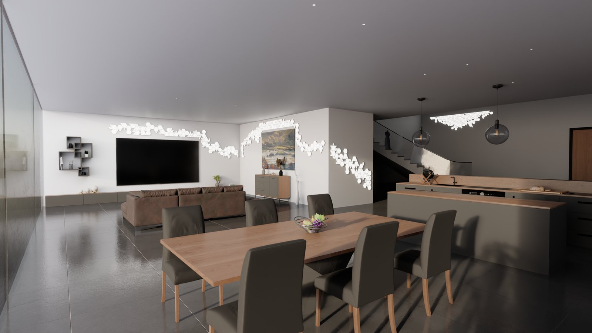 | 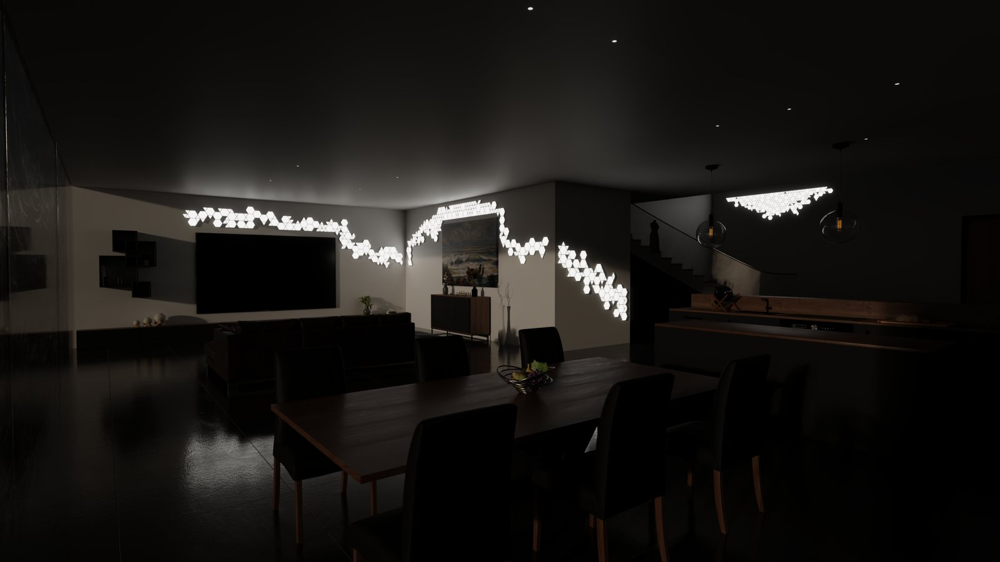 |

- **Budget:** ≈40 mA per RGBW LED at full output on the 5 V rail (§3.2, datasheet). A hexagon with 18 LEDs draws ≈0.73 A at 5 V (≈3.7 W), or ≈4.3 W from +24V through the buck at ≈86% (≈0.18 A). 100 hexagons at full output is ≈430 W, so one 100 W Class 2 supply feeds roughly 23 hexagons.
- **Standby:** With so few LEDs, idle draw is dominated by the MCU and CAN transceiver (≈0.3–0.5 W per panel). MCU sleep and CAN transceiver standby with wake-on-bus are required. The per-panel **LED rail is switched by a P-MOSFET on the controller board** (V6.0; the 5 V buck stays on for the MCU and CAN transceiver), so LEDs draw nothing in standby; the spare contact (X8) is no longer needed for that. Domain-level supply switching remains an option for full off.
- **Brightness limiting:** The coordinator enforces a **per-power-domain current budget**, scaling global brightness to fit each PSU. This is mandatory.
- **Brightness normalised per shape ([decision 0017](docs/decisions/0017-brightness-normalised-to-lowest-led-density.md)):** each panel's 100 % is scaled to the shape with the fewest LEDs per area (today the hexagon), so every shape shows the same surface luminance: hexagon up to full output, square ≈53 %, triangle ≈26 %. Estimated maximum ≈1,570 cd/m² on the film.
- **Power domains:** Each PSU feeds a domain through an **injection bridge** (a bridge PCB variant with a supply input and a **time-lag fuse**: rev A uses a Bel 0685T5000-01, LCSC C3163312, 5 A slow-blow, 63 V DC, 1206, with wire pads at both bridge ends). It must be time-lag so that a panel's own PTC (F1, §3.2) trips first and only that panel goes dark. Neighboring domains are joined by **isolating bridges**, a PCB variant with the +24V traces left unconnected. These carry GND, CAN, and SENSE/DRIVE, so PSUs never back-feed each other.
- **Bridge current rating:** Each joint has two +24V springs and three GND springs per board. The BW0019-series spring's rating is not yet confirmed; assume ≈1 A per spring (≈2 A, ≈48 W, of +24V per bridge path) until measured. Domain size and injection spacing follow from the measured number. If that is too low, add power pads and springs (≈$0.02 each).
- **Thermal:** Lanes are sized for the worst-case current through a panel acting as a feed path (halved at 24 V).

## 9. Mechanical

| Back plate | Back plate, wall side | Frame |
|---|---|---|
| 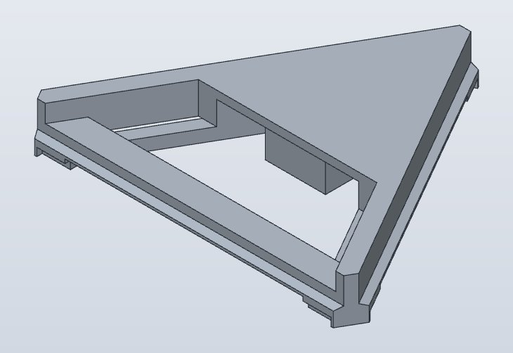 | 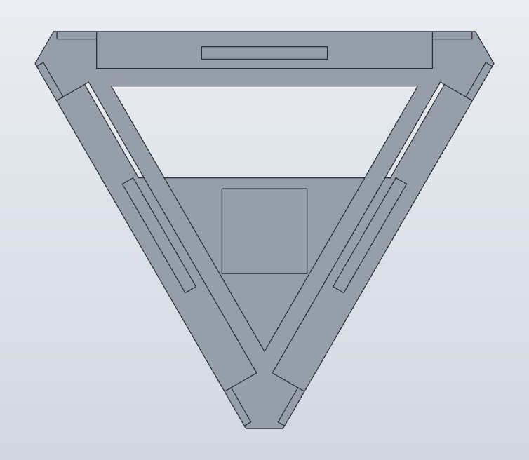 | 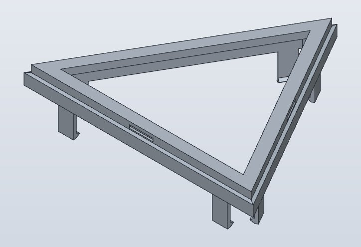 |

| Bezel and film | Bridge clip | Edge cover |
|---|---|---|
| 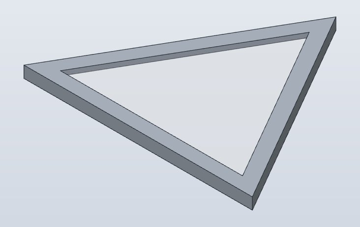 | 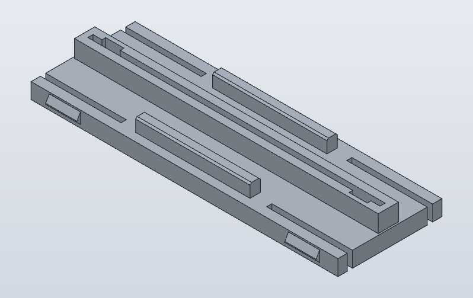 | 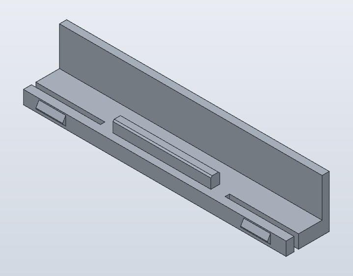 |

| Section through a clip tooth | Section through a frame hook |
|---|---|
| 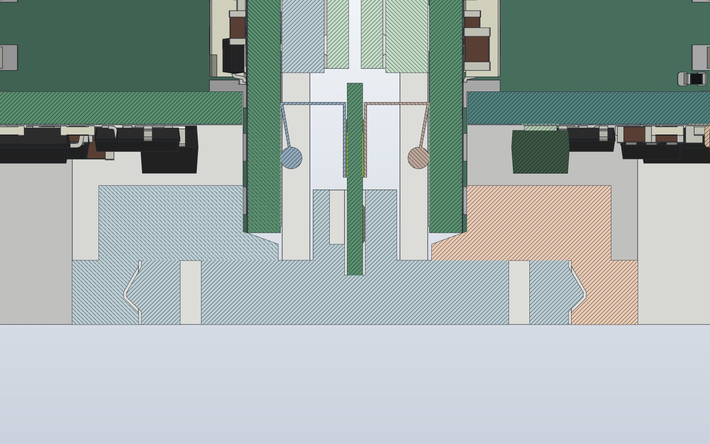 | 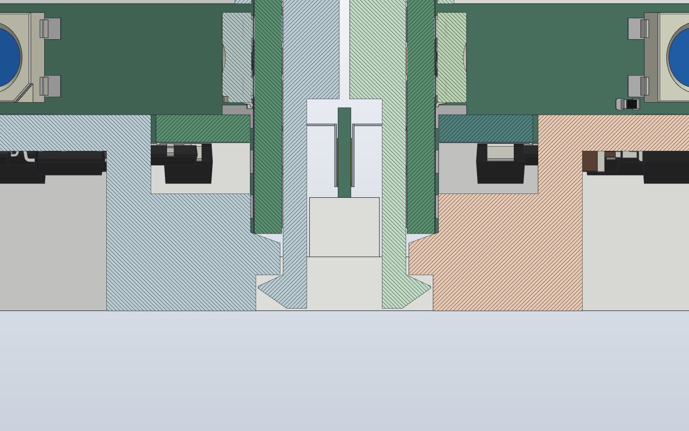 |

Rev A hexagon mechanics are modelled in `mechanical/archive/openscad-panel/` (OpenSCAD, parametric; `MECH-NOTES.md`), per [decision 0012](docs/decisions/0012-panel-mechanics-rev-a.md).
- **Frame (crown):** board top edges sit in a groove; 12 snap legs in the seam band; the corners are closed (wall, groove and lip run all the way round, with 1.2 mm reliefs for the corner solder), and the edge-board ring is soldered on a separate jig before it goes into the frame. White PETG, printed cap down.
- **Back plate:** its top is the chamber floor (z 6.6); its rim takes the springs' inward push. The controller pocket is open through to the wall (meets the §3.5 stepped-pocket rule), giving wall-side jig and iron access.
- **Bridge clip:** rigid snap fit with zero play, see §3.3 ([decision 0014](docs/decisions/0014-rigid-snap-bridge-clip.md)). The frame keeps its 12 snap legs (|x| 30–36.5); the clip ends inside |x| ≤ 29.5. CAD moves to SolidCraft (`mechanical/solidcraft/`).
- **Wall mount:** **3M Dual Lock** pads on the back plate's wall face, clear of the controller pocket on every shape ([decision 0013](docs/decisions/0013-dual-lock-mounting-fdm-rules.md)). There's no puck, no wall screws and no holes in the reflector; the seam's ≈7 N spring push is far below the pads' shear capacity. Only some panels need pads: the clips make the cluster rigid, and the clip sets the seam width (no spacing gauge). The panel back plane is z ≈ −4.3 (clip and lug bottoms). The cluster is hung after assembly; adding a panel means taking it down first (accepted by the user). The decision 0012 wall puck stays in the model as an unused fallback.
- **Diffuser:** film clamped straight between the frame cap and a bezel (no riser: removed by the user on 2026-11-21, [decision 0014](docs/decisions/0014-rigid-snap-bridge-clip.md)). The film sits ≈2.1 mm above the board top. **The bezel has an L-section:** a 1 mm × 3 mm flange down its outer edge sits flush in a step cut into the frame's outer top edge, which stiffens the thin bezel (a test print bowed) and locates it; one snap detent per side (a 0.45 mm bump on the flange's inside, into a dimple in the frame) holds it, relying on PETG's flex, with no pins or arms (user, 2026-11-22). The film stops 1.5 mm inside the outer edge, inside the flange.
- **Panel depth:** board stack ≈20.9 mm plus the engaged Dual Lock thickness (≈4–6 mm, depending on the type), With no riser, the film height is fixed; if the optics test shows hot spots, the fix is a taller frame cap (a frame parameter), not a separate riser.
- **FDM design rules ([decision 0013](docs/decisions/0013-dual-lock-mounting-fdm-rules.md)):** if a part uses round or split snap posts, their lips are **ovalized** (they protrude only in the direction the split flexes); **glue and M2/M3 screws** are allowed, threading straight into the plastic through tapered-entry pilot holes (no heat-set inserts); overhangs up to 70° from vertical; steeper only with support standing on the bed, never support trapped between surfaces of the same part; walls ≥ 0.75 mm; fits per side: **tight 0.08–0.1 mm**, **loose 0.15–0.2 mm** (user, 2026-11-21).
- **Edge-board keep-outs** (reserved for these reasons only): exterior face z 0–7.5 at |x| 30–36.5 (snap legs); inward face z ≥ 12.8 (frame lip); inward face below z 6.6 flat copper only (bears on the plate rim); nothing below the wall edge at |x| 30.4–36.1.
- **Still to do:** check the square and triangle variants (the triangle needs a shorter, offset puck); tune the back-plate snap force (≈90 N) after a test print; ceiling mounting.

## 10. Open Items / To Verify
See also [docs/gap-analysis.md](docs/gap-analysis.md) for the full pre-project gap list and cost estimate.

1. ~~**LED logic level**~~ — **Closed (V5.3):** the SKC6812RGBW needs ≈3.5 V, so an SN74AHCT1G125 shifts PA7 to 5 V. (V5's WS2815B worked from 3.3 V directly.)
2. ~~**CH32V203 package**~~ — **Closed (V5):** CH32V203F6P6 (TSSOP20) has CAN and 224 KB flash total. The F8P6 has no CAN.
3. ~~**LED part**~~ — **Decided (V5.3):** SKC6812RGBW-NW (RGBW, 5 V). Still to confirm from the datasheet and optics test: current per channel, PWM frequency and low-level dimming, and thermal performance in a closed cavity. (PA6 5 V tolerance is resolved: it is not FT, so the loop-back keeps its divider, V5.7.1.)
4. **Bridge contacts:** Prototype the seam bridge with the BW0019-series springs. Confirm their datasheet ratings. Measure contact resistance, current per spring, contact force, insertion without snagging, seam width, carrier retention, and tolerance to a few mm of wall unevenness. The Harwin flat bridge (decision 0001) is the fallback.
5. **LEDs per edge:** Final count and pitch once the board outline and contact-pad position are set.
6. **Coordinator host:** Raspberry Pi vs. one cluster controller elected as coordinator.
7. **Coordinator integrations:** Home Assistant / MQTT / app control.
8. **ESP32 variant:** Confirm C6 vs. S3 (CPU/RAM needs once the voxel engine and coordinator duties are sized).
9. **Panel shape source:** LED loopback auto-detect vs. a stored firmware setting. Both are supported by the hardware; choose which is primary.
10. **Discovery thresholds:** Calibrate the code voltages with the series diode on real hardware (§4.2).
11. **Seam inset d:** Measure the bridge + compressed-spring stack on the prototype, then recompute the per-shape board lengths from the §2 formula. ≈3.5 mm is assumed until then.
12. ~~**Exterior signal bus / H = 22 mm (decision 0005)**~~ — **Superseded (V6.0)** by decision 0009.
13. ~~**Edge board height**~~ — **Rev A: H = 13.5 mm** (V6.5, layout DRC 0). The optics test decides whether a later revision can go lower.
14. ~~**Controller board**~~ — **Closed (V6.3):** layout done, DRC 0, fab outputs in `hardware/controller-board/output/fab/`.
15. ~~**24 V protection sizing**~~ — **Closed (V6.2, decision 0011).** PTC chosen in V6.2.1: mSMD050-60V.
16. ~~**LED-rail switch**~~ — **Closed (V6.2):** AO3401A + 2N7002 from PA0, ≈0.9 ms soft start.
17. **Heights (rev A interface):** controller side confirmed (V6.3): underside z = 5.0, top/chamber floor z = 6.6, J4 origin z = 5.25, J1/J4 pads x = ±11.43 mm. **LED centres moved to z ≈ 9.8 mm** (LED ≈7.3–12.3 mm, centred in the visible wall 6.6–13), because at 9.4 the LED bottom sat only 0.3 mm above the controller top. **Edge side confirmed (V6.5):** H = 13.5; LEDs at x −31.2/0/+31.2, centre z 9.8 (body 7.37–12.23); J4 pads 1.3 × 2.85 mm at z 2.5–5.35 since V6.9.2 (2.5 mm of fillet land below the controller; origin unchanged); contacts end z 6.0; spring contact ≤ z 5.0.
18. **Seam inset d:** at d = 3.5 the springs compress to 3.1 mm, near their 3.0 mm minimum; d ≈ 3.8 would centre them. Rev A boards keep d = 3.5 lengths: the seam width is set by panel spacing (the printed spacing gauge), so the spring coupon decides the spacing without a board change. If a later revision changes d, re-derive L_board (decision 0004).

## 11. Changelog
**V6.9.5 (2026-11-22)** — bezel stiffened and re-fixed (user, after a test print bowed): L-section bezel with an outer flange in a matching step on the frame (step floor at the 70° overhang limit); snap detents replace the corner pins; film inset 1.5 mm, no pin holes.

**V6.9.4 (2026-11-21)** — documentation only: generated figures (renders, CAD, cross-sections, boards in 3D) embedded in §2, §3.3, §3.5, §8 and §9. This file and the decision records are the only written description; the HTML explainer is retired to `docs/archive/explainer/` (user: no second source of truth).

**V6.9.3 (2026-11-21)** — panel brightness normalised to the shape with the lowest LED density (the hexagon); squares and triangles are scaled down to match ([decision 0017](docs/decisions/0017-brightness-normalised-to-lowest-led-density.md), user). The bridge clip's fuse reliefs are open channels through the spine top, so an injection bridge can be inserted.

**V6.9.2 (2026-11-21)** — pre-order fixes (user; roadmap 2.0, 2.0b, 2.0c; [decision 0015](docs/decisions/0015-square-triangle-edge-boards.md)):
- **No edge-board parts below z 6.8 on the inward face.** The board ring is soldered first and then lowered into the back plate along z, so the V6.9 R3 groove made insertion impossible. R3 is now an 0402 at z 7.2 just under LED1's DIN pad, and the back-plate edge is plain again.
- **J4 pads extended to z 2.5–5.35** (1.3 × 2.85 mm): 2.5 mm of exposed fillet land under the controller (was 1.5), 0.35 mm behind its edge. The low band under J4 moved down to z 0.5–2.05; +5V_LED now passes 0.8 mm under the J4.1 (+24V) pad with the GND guard between them.
- **Square back plate:** Dual Lock bosses back to 25 mm (as on the hexagon); only the part inside the controller pocket is cut away (user).
- **Bridge clip and edge cover:** square plate corners (no 3 mm rounding); snap arms 1.8 × 15.5 mm (thicker and shorter, ≈3× stiffer); base 3.0 mm (was 3.5; clip top z −1.3), keys to z 1.2, so the keys engage 2.5 mm (was 1.5, of which 0.7 mm straight); the chamfer is on the key only; teeth 0.7 mm. The back-plate tab over the clip recess is 0.75 mm thick (was 0.25).

**V6.9.1 (2026-11-21)** — printing and snap fixes (user review of the CAD):
- **Frame hooks:** 1.2 mm engagement (was 0.8) on a latch plane at z −2.3 under the board tab, with a ≥ 1.75 mm ledge. The seat slope had thinned the old ledge to almost nothing.
- **Board seat:** 20° slope from the plate edge through the board's inner bottom corner (no flat, more material in the tab).
- **Square Dual Lock bosses:** 14 mm at r 20, so they clear the controller pocket. The cross-bar starts at the pocket's base line.
- **Injection wires:** routed along the seam and down its centre; no grooves.

**V6.9 (2026-11-21)** — **the rev A test prototype is triangle panels** ([decision 0016](docs/decisions/0016-triangle-test-model.md), user).
- **Edge boards as alike as possible (user):** all three outlines come from one layout. The hexagon left its hand-reviewed layout (archived) and now differs from the triangle only in its outer LED x and its end zone.
- **Inward-face part zones:** no part at z < 3.4 or z 5.4–6.8. C1/C3 moved to z 9.6 in the hop gaps (x −15.4 / +19.8). R3 sits at z 4.4 in a new 1.2 mm groove in the back-plate rim (z 3.4–5.4). Found by the first assembly clash check with square and triangle boards ([decision 0015](docs/decisions/0015-square-triangle-edge-boards.md)).
- **Printed parts are parametric in the number of sides:** back plate, frame and bezel each have Hexagon / Square / Triangle configurations in one SolidCraft file. Per-shape STL (finest mesh) and STEP exports.
- **Back plate (user):** the four controller ledges are removed (unprintable overhangs; the controller hangs on its J4 joint), and the board seat slopes at 45° so nothing flat faces the bed in the floor-down print.
- **Frame:** the inner lip is a mitred ring (a straight box would poke into the neighbouring board at the triangle's 60° corners).
- **Assembly:** a mixed cluster (2 hexagons, 1 square, 2 triangles) with every board STEP, clip and bridge. No interference between parts.

**V6.8.6 (2026-11-21)** — square and triangle edge boards laid out (DRC clean); LED x positions are per shape at about L_board/3, replacing the shared ±31.2; edge-board KiCad projects renamed `edge-board-hex/-square/-triangle`; superseded V5 board and OpenSCAD model moved to `hardware/archive/` and `mechanical/archive/` ([decision 0015](docs/decisions/0015-square-triangle-edge-boards.md)).

**V6.8.5 (2026-11-21)** — frame corners closed (wall, groove and lip run all the way round, with corner reliefs for the solder); the edge-board ring is soldered before it goes into the frame, so the frame is no longer the corner-soldering jig (user).

**V6.8.4 (2026-11-21)** — first SolidCraft pass, user changes: panel back flush with the clip bottom (lugs replaced by notches in a clip recess), removable clip teeth (both faces obtuse), diffuser riser removed (bezel clamps the film on the frame cap), frame cap and wall made one part.

**V6.8.3 (2026-11-21)** — FDM rules: minimum wall 0.75 mm; fit gaps per side tight 0.08–0.1 mm, loose 0.15–0.2 mm (user). Bridge-clip keys use the tight fit.

**V6.8.2 (2026-11-21)** — bridge-clip keys are straight-sided with a top chamfer, not tapered, so a pull between panels never pushes the clip off (user); zero play comes from a close key-in-groove fit.

**V6.8.1 (2026-11-21)** — bridge clip corrected: tapered keys in back-plate grooves carry the pull between panels; snaps (sloped latch faces) only keep the clip on; controller-side cross-bar thickened. FDM overhang rule recorded ([decision 0014](docs/decisions/0014-rigid-snap-bridge-clip.md), decision 0013).

**V6.8 (2026-11-21)** — [decision 0014](docs/decisions/0014-rigid-snap-bridge-clip.md): rigid snap-fit bridge clip with zero play replaces the captive-with-float carrier; panels form one rigid cluster; universal ≈59 mm clip with lugs on the back plates (cross-bar on the controller side); edge covers for free edges; cluster assembled off the wall; spacing gauge dropped. Mechanics CAD moves to SolidCraft.

**V6.7.1 (2026-11-21)** — with the wall mount dropped, the bridge carrier no longer needs to be flush with the panels' wall side; the ovalized-lip rule applies only where split snap posts are used (user clarification).

**V6.7 (2026-11-21)** — [decision 0013](docs/decisions/0013-dual-lock-mounting-fdm-rules.md): 3M Dual Lock wall mounting replaces the wall puck (it frees the triangle's centre for the controller and removes the holes from the reflector); FDM design rules (ovalized lips on any split snap post, M2/M3 screws into tapered pilot holes, glue allowed).

**V6.6 (2026-11-21)** — bridge carrier is captive with float: a slightly loose snap fit keeps it from falling out when a side has no panel; it replaces the free-edge screw-tab variant (user request; decision 0012 updated).

**V6.5 (2026-11-21)** — edge board, seam bridge and spring coupon laid out (ERC/DRC/parity 0).
- **Edge board:** H = 13.5 mm; LEDs centred at z 9.8, evenly spaced (x 0, ±31.2 hexagon / ±29.9 square / ±27.4 triangle); J4 pads z 3.5–5.7; contacts end at z 6.0; spring contact ≤ z 5.0.
- **Corner pads:** rev A sizes, pitch and heights recorded (§3.4).
- **Bridge:** 56 × 9.0 × 0.8 mm; injection fuse Bel 0685T5000-01.
- **Open items:** 13 closed; 17 updated; 18 (seam inset) added.

**V6.4 (2026-11-21)** — rev A panel mechanics modelled ([decision 0012](docs/decisions/0012-panel-mechanics-rev-a.md)): floating bridge carrier, one wall puck per panel, 3 mm wall standoff, clamped diffuser film, frame as corner-soldering jig, edge-board mechanical keep-outs, bridge envelope. §9 rewritten.

**V6.3 (2026-11-21)** — controller board laid out (DRC 0, fab outputs ready).
- **Outline:** 72.0 × 24.0 mm trapezoid, 60° sides, 4-layer, white mask.
- **Pocket:** a stepped pocket (≥2.8 mm everywhere plus an open window under L1) replaces the uniform ≥5 mm pocket.
- **Interface:** J1/J4 positions and keep-outs recorded; LED centres raised to z ≈ 9.8 mm for clearance over the controller.
- **Layout rule:** the buck's SW/BOOT/EN nodes count as 24 V-tolerant.
- **Open items:** 14 closed; 17 updated.

**V6.2.2 (2026-11-16)** — LEDs centred along the edge board and evenly spaced (user request).

**V6.2.1 (2026-11-16)** — per-panel PTC chosen: F1 mSMD050-60V (C70113) on `+24V_IN`; test pads TP10 (before F1) and TP13 (after); injection-bridge fuse must be time-lag (§8).

**V6.2 (2026-11-16)** — controller schematic implemented; 24 V fault protection ([decision 0011](docs/decisions/0011-24v-fault-protection-controller.md), accepted by the coordinator under the user's delegation).
- **DRIVE:** open-drain 2N7002 + 470 Ω.
- **SENSE:** R10 = 10 kΩ.
- **3V3:** TLV431 shunt.
- **CAN TVS:** NUP3105LT1G.
- **Per-panel PTC** upstream of the SMAJ28A.
- **Buck values fixed:** TPS54360B, 22 µH FNR6045S220MT (4.5 mm), so the back-plate pocket is ≥5 mm.
- **LED-rail switch:** AO3401A (+5V_LED).
- **Joint:** 10 pads at 2.54 mm in a fixed order.
- **Code-0 option:** R3.
- **Discovery codes** re-estimated.
- **Layout rules:** the DRIVE adjacency rule demoted to a preference, and the +24V adjacency rule generalised.
- **Open items:** 15 and 16 closed; 17 (rev A heights) added.

**V6.1.1 (2026-11-16)** — clarification only: BW0019CG datasheet values added to §3.3 (30 mΩ, 60–80 gf, 20k cycles, working height 3.0–3.5 mm, no current rating). Seam ≈6.8–7.8 mm, d ≈3.4–3.9 mm, consistent with the 3.5 mm assumption.

**V6.1 (2026-11-16)** — controller board shape (refines decision 0009).
- The controller board is sized for the triangle, the smallest panel: a trapezoid with 60° sides, base ≤ ≈72 mm along the code-0 board, depth ≈20–25 mm. A rectangle the length of the edge board would not fit a triangle (§3.5).

**V6.0 (2026-11-16)** — rear controller board and 24 V bus ([decision 0009](docs/decisions/0009-rear-controller-board.md), [decision 0010](docs/decisions/0010-24v-bus.md); both approved by the user).
- **All edge boards are passive** (2-layer, one design per shape). The MCU, CAN, regulators and 5 V converter move to a small 4-layer **controller board** at the rear of the light chamber, with parts facing the wall in a back-plate pocket and white mask facing the chamber. It is drag-soldered at 90° to the code-0 edge board (≈10 pads).
- **Edge board height target 10–15 mm** (was 22 mm). The zoning rules are dropped: lanes and the bus may run on either face, and only constraints with a stated reason remain (§2).
- **24 V bus:**
  - Parts: TPS54360B buck (always on), P-MOSFET LED-rail switch on PA0, TCAN1044V CAN transceiver (±58 V), SMAJ28A, HT7533 fed from +5V.
  - R10/R11 and the CAN TVS to be re-sized.
  - +12V → +24V on the contacts, corners and bridges.
- **Superseded:** decisions 0005 (H = 22 mm, lane stack), 0006 (active/passive edge boards) and 0007 (active-board-only in-pad vias, now allowed everywhere). Decision 0008's pins (PA0 LED_EN, PA6 loop-back) carry over to the controller board.
- Open items 13–16 added.

**V5.7.2 (2026-11-16)** — active board inner-copper criterion (follow-up to decision 0006, measured on the routed board).
- §2: the "+12V region ≥10 mm wide at 0.5 oz" rule of thumb is replaced. 0.5 oz passes if end-to-end R ≤10 mΩ, no neck is <6 mm, and no neck <8 mm is longer than 5 mm; otherwise, or if the fuse is >5 A, use 1 oz. The rev A board passes (9.4 mΩ, worst neck 6.25 × 3.7 mm), so it can use 0.5 oz inner copper with a ≤5 A fuse.
- §2: the In2 separation between +12V and +5V may be a GND guard ≥1 mm **or** a copper-free gap ≥1.5 mm. The rev A west half uses a 2.0 mm gap.

**V5.7.1 (2026-11-16)** — clarification only, no design change.
- PA6 confirmed **not 5 V tolerant**: the CH32V203 datasheet V2.8 pin table has no FT mark on TSSOP20 pin 12. The 2.2 k / 3.3 k loop-back divider is required (§3.2). §10 item 3 updated.
- The active schematic generator now carries the decision 0008 pin swap. The schematic notes (R7 description, note 3) now name PA6 and TIM3.

**V5.7 (2026-11-16), continued**: MCU pin swap LED_RET ↔ LED_EN ([decision 0008](docs/decisions/0008-mcu-pin-swap-led-ret-led-en.md), **accepted**: the user approved it in the PCB session).
- LED_EN (buck enable) moves to **PA0** (pin 6). The LED loop-back LED_RET moves to **PA6** (pin 12; TIM3_CH1 external clock, or SPI1_MISO).
- Why: each signal now leaves U1 on the side its parts are on, which let the active board route completely.

**V5.7 (2026-11-16)** — vias in the J1 pad tops on the active board ([decision 0007](docs/decisions/0007-vias-in-pads-active-board.md), **accepted**: the user approved vias in pads in the PCB session on 2026-11-16).
- Each J1 contact pad on the active board gets its plane/signal vias in its top end, in one row at y = 7.65 (4 per power pad, 1 per signal pad). This replaces the via fields above the strip, which blocked every MCU-to-strip route.
- New bridge constraint: the spring's final contact point must be ≤ 6.8 mm from the wall edge.
- Corner pads: in-pad vias are allowed but not used. The F.Cu DRIVE/SENSE pads sit directly behind the +12V pad, inside the 0.5 mm rule. The passive board is unchanged.

**V5.6 (2026-11-15)** — active/passive board split ([decision 0006](docs/decisions/0006-active-passive-board-split.md), **accepted**: the user approved it on 2026-11-15, relayed by the PCB session).
- Two edge-board designs per shape: **active, 4-layer** (`hardware/archive/edge-board-v5/`) and **passive, 2-layer** (`hardware/edge-board/`). They replace the single PCB with population variants. Why: a Freerouting probe left 7 of 53 active-board connections unrouted on 2 layers.
- Active 4-layer stack: In1 GND, and In2 power with GND under the bus band. The passive board keeps the V5.5 lane stack.
- The interface contract (§3.5) keeps both layouts mechanically and electrically interchangeable at the bridges and corners.
- Schematics: R3 (passive-only link) removed; the passive board uses a plain net. Active R1 fixed at 0 Ω. Both schematics are generated from one source, with ERC 0 violations on each and 0 mismatches on the shared parts and interface nets.

**V5.5 (2026-11-15)** — exterior signal bus and 22 mm board height ([decision 0005](docs/decisions/0005-exterior-signal-bus-h22.md), **accepted**: the user approved it on 2026-11-15).
- The corner-to-corner signal bus moves to the exterior face (B.Cu), in a band above the +5V lane. This is the second exception to the §2 "exterior = power" zoning.
- The edge board height is fixed at **H = 22 mm** (PCB placement: all 67 parts fit, 0 courtyard overlaps, on the hexagon outline and the triangle-length core). The alternative is H = 24 mm with the bus on F.Cu.
- Two board-only NPTH jig tooling holes were added in the PCB.
- The SENSE/DRIVE BAT54S clamps (D2/D3) moved from the bus side to the MCU side of R10/R11, so a bus short to +5V is limited by the series resistor instead of pumping 3V3 above 4.0 V. ESD clamping at the MCU pins is unchanged: series resistor, then clamp.

**V5.4 (2026-11-15)** — board length per shape ([decision 0004](docs/decisions/0004-per-shape-board-lengths.md)).
- The seam bridge needs a fixed gap, so every board's exterior face sits a fixed d = seam/2 from the seam centreline. The edge length L ≈ 100 mm is now defined on the seam centrelines.
- Board length therefore depends on shape: L_board = L − 2·(d + t)/tan(α/2). At d = 3.5 mm that is ≈94.1 mm (hexagon), ≈89.8 mm (square) and ≈82.3 mm (triangle).
- One schematic and a centred layout core that fits the triangle length, with three board outlines. Bridges stay universal.
- **Rev A builds the hexagon only.**
- Open item 11 added: measure d, then recompute the lengths.
- **Schematic implemented (V5.3 + V5.4):**
  - Buck values per the TI 5 V reference (§3.2), EN on PA6 with a pull-down, and a 2.2 k / 3.3 k divider into PA0 (PA0 is not 5 V tolerant).
  - Corner power pads ordered +5V / GND / +12V, with GND between the supplies (§3.4).
  - New footprint `LED_SKC6812RGBW_5050-4` per the OPSCO datasheet; the -NW/-WS/-BW pinouts are identical.
  - ERC 0 violations. PCB placement is in progress.

**V5.3 (2026-11-15)** — RGBW LEDs ([decision 0003](docs/decisions/0003-rgbw-leds-5v-rail.md)).
- LED changed from WS2815B-V1 (12 V RGB) to **SKC6812RGBW-NW** (5 V RGBW, neutral white). No 12 V RGBW LED with a built-in driver exists at LCSC.
- New **per-panel 5 V LED rail**: TPS54202 buck on the active board. Its enable pin is the switched LED rail for standby.
- New **SN74AHCT1G125** level shifter for LED data.
- Corner nets: **LED BIN removed** (no backup data line), **+5V added** on the exterior face.
- Loopback counts 32 bits per LED. PA6 is freed.
- Cost ≈ +$0.85–1.10 per hexagon. LEDs are now protected from 12 V overshoot.

**V5.2 (2026-11-15)** — low-cost seam bridge ([decision 0002](docs/decisions/0002-seam-bridge-cheap-springs.md)).
- The bridge now stands **upright in the seam** (thin double-sided PCB plus printed carrier) instead of lying flat on the wall. It uses **top-contact LCSC springs** (BW0019CG-L3.5W1.5H4.3, ≈$0.024) instead of Harwin side springs (≈$0.16–0.33): ≈$0.70–1.20 per bridge instead of ≈$3.40–7.15.
- **Edge contacts moved to the exterior face only:** 10 pads (X1–X10, 3 × GND, 2 × +12V, 5 signals). The inward-face contact pads are removed. Signals reach their pads through vias.
- Seam ≈6–8 mm (was ≈10–11 mm). The springs push panels apart, so the panel frame and snap fit must take that force.
- Bridge current is assumed ≈1 A per spring until measured. §7.2, §8, §9 and open item 4 were updated to match.
- Footprint and schematic implemented: DRIVE (X6) and SENSE_EDGE (X7) were swapped from the first draft so DRIVE never neighbours a pad that can carry 12 V. The footprint includes a no-pour/no-via rule area and a full mask opening over the contact strip.

**V5.1 (2026-11-15)** — PCB review fixes.
- Edge contacts made **symmetric**: 5 pads per face at the same positions (7 mm pitch), exterior GND/+12V/GND/+12V/GND, so opposing springs balance. The seam-interleave offset was dropped; the seam is now ≈10–11 mm with S1961-size springs.
- S1961-46R is now the default spring on both faces. S1941-42R is optional for the exterior.
- Corner joints split into mirror-image left/right footprints (`CornerJoint_L` for IN, `CornerJoint_R` for OUT). Corner +12V/GND pads are now SMD on the exterior face (no through-holes).

**V5 (2026-11-15)** — edge board parts selected and schematic captured ([decision 0001](docs/decisions/0001-edge-board-parts.md)).
- **Bridge contacts redesigned:** V4's gold fingers + card-edge sockets are replaced by **SMT spring fingers on a flat bridge PCB** gripping plated pads on both faces of each edge board, with a 3D-printed snap fit for retention. The edge pinout is no longer a palindrome; the bridge routes nets, including the SENSE↔DRIVE cross. Pad layout and staggered mating are in §3.3.
- **MCU fixed to CH32V203F6P6.** The F8P6 has no CAN; all V203 parts have 224 KB flash. An 8 MHz crystal was added for CAN timing.
- **Discovery:** a series diode was added to each ID resistor to block sneak paths through idle neighbours. The code voltage table was updated (§4).
- **20 AWG power crossover jumpers removed;** the power contact pads are on the power-plane face.
- **Parts selected:** SN65HVD230DR, HT7533-1 + 68 Ω, SMAJ15A, PESD2CAN, BAT54S, WS2815B-V1 (3.3 V drive confirmed). Loop-back on PA0/PA6 and LED data on PA7.
- Open items 1 and 2 closed; item 4 reworded for the spring bridge; item 10 added.

**V4 (2026-11-14)**
- Added goal/scope, a terminology table, and the scale target (multi-room, 100+ panels, personal build).
- MCU changed from CH32V003 to **CH32V203** (native CAN, room for the effect engine and bootloader). The bus is now **CAN** (the RS-485 option was dropped).
- Clarified that the edge connector is the gold fingers that snap into bridges, and that corner connections are internal board-to-board joints.
- Replaced the shared-sense-trace resistor ID with the **SENSE/DRIVE cross-connected discovery scheme**. ID resistors connect only to their own edge's finger. The active board uses code 0 (0 Ω).
- Added the palindromic edge-connector **mirror rule** and a reference pinout.
- Fixed the regulator spec (dissipation, not dropout).
- Added a **snap-on ESP32 cluster controller** per flat cluster: it owns the cluster's CAN bus and has a buck supply, Wi-Fi, and an optional power input. Clusters on different planes link over Wi-Fi only.
- Gravity and orientation come from the AR app (ARKit/ARCore frames are gravity-aligned). IMUs and accelerometers were removed from the design.
- Added distributed rendering, cross-cluster time sync, power domains / isolating bridges, the CAN bootloader, and open items.
- Bridges are now **off-the-shelf low-profile card-edge sockets on a bridge PCB** (optional printed enclosure); custom springs were dropped. The edge connector has fingers on both faces (power exterior, signals inward). The reference pinout is now 2 × 12.
- Added AR placement detail: space-time colour codes per panel, the ARKit pipeline, multi-room joining, RoomPlan.
- Added building-scale voxel effects with path distance through doorways (§6.1).
- Gap analysis and cost estimate: [docs/gap-analysis.md](docs/gap-analysis.md).
- Added the **LED loopback** (last LED → MCU) for LED counting, shape detection, and chain diagnostics. The shape-strap resistor was dropped.
- Edge length reduced to **≈100 mm**, LEDs reduced to **2–3 per edge**, and the diffuser changed from opal acrylic to **LCD-style diffuser film**. Power and standby budgets were updated to match.

**V3** — Original Google Doc specification.
